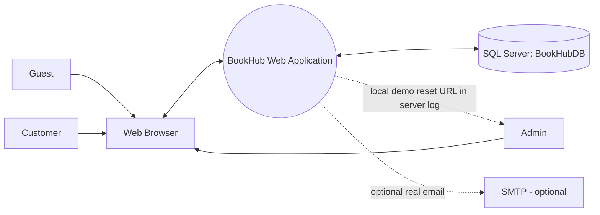
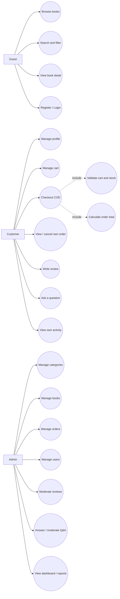
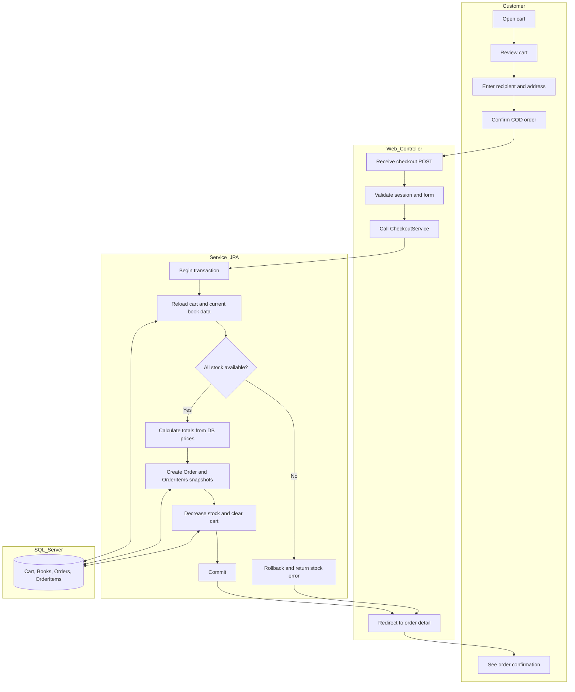
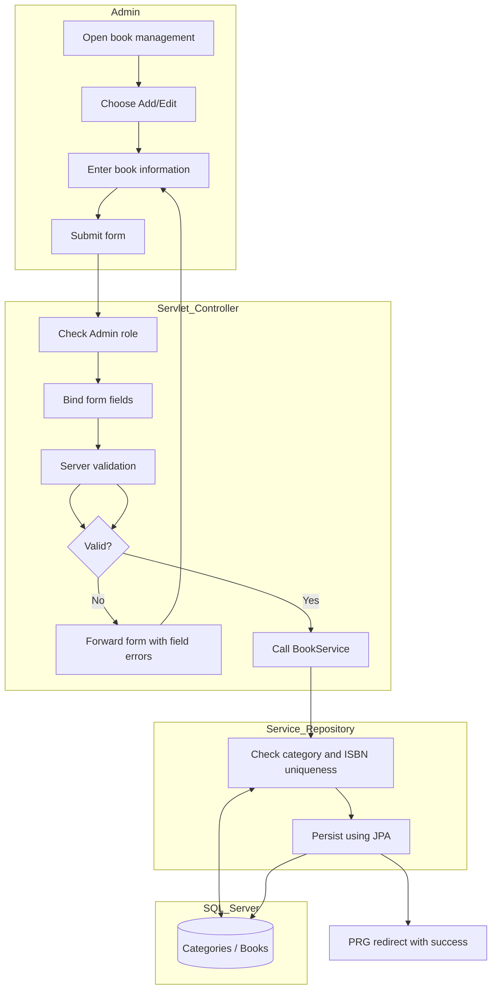
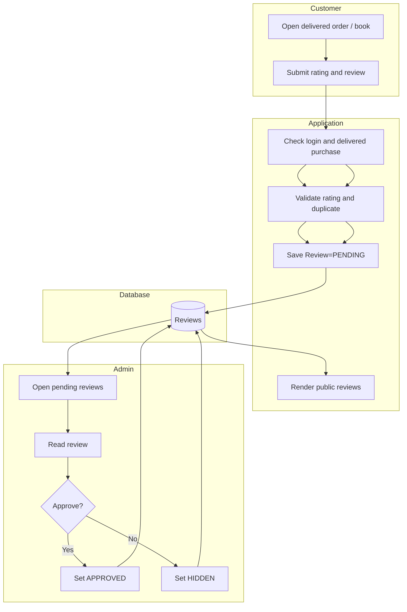
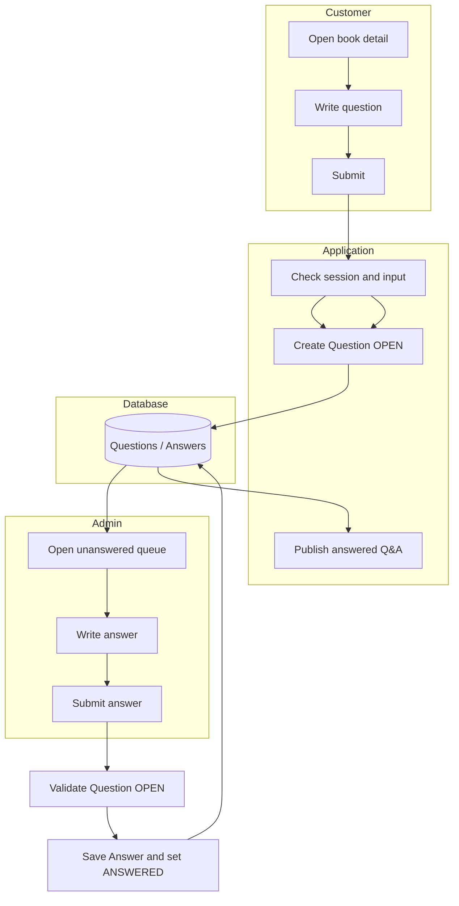
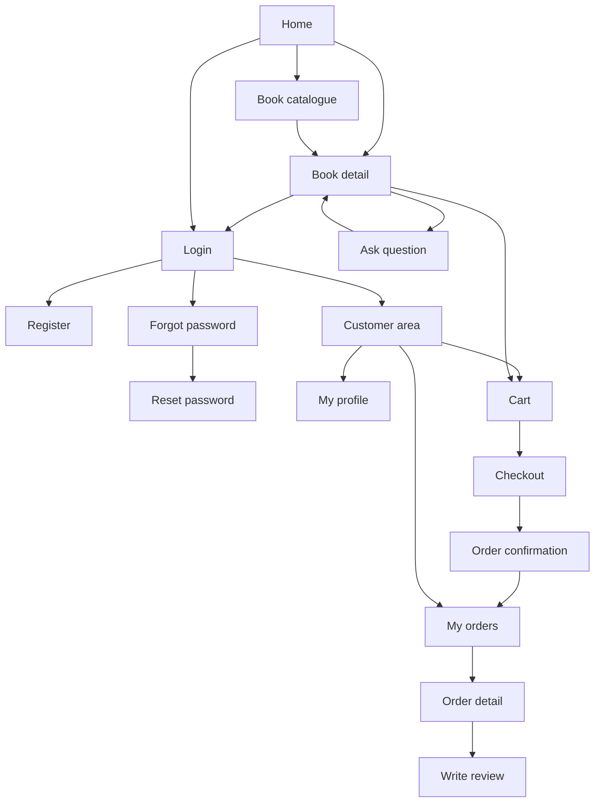
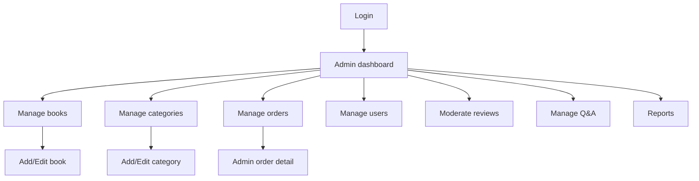
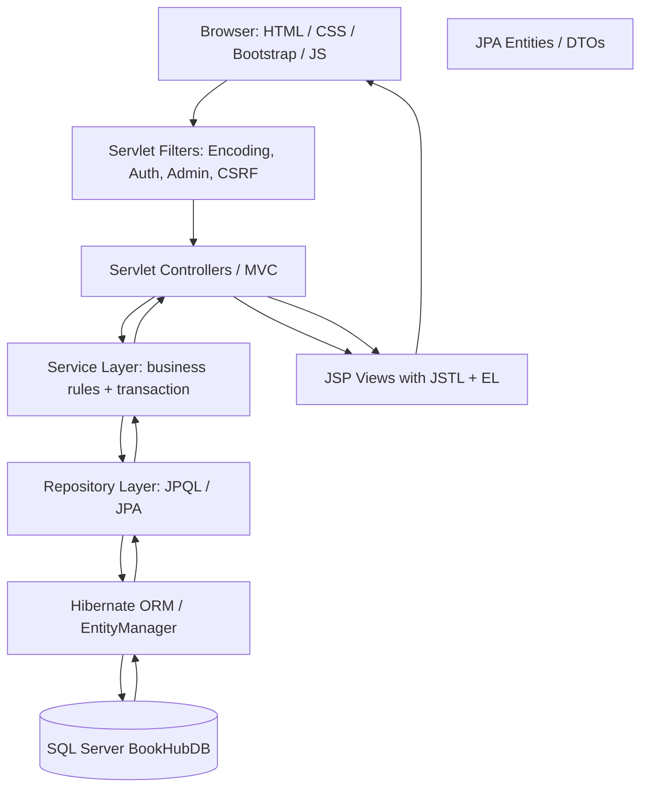
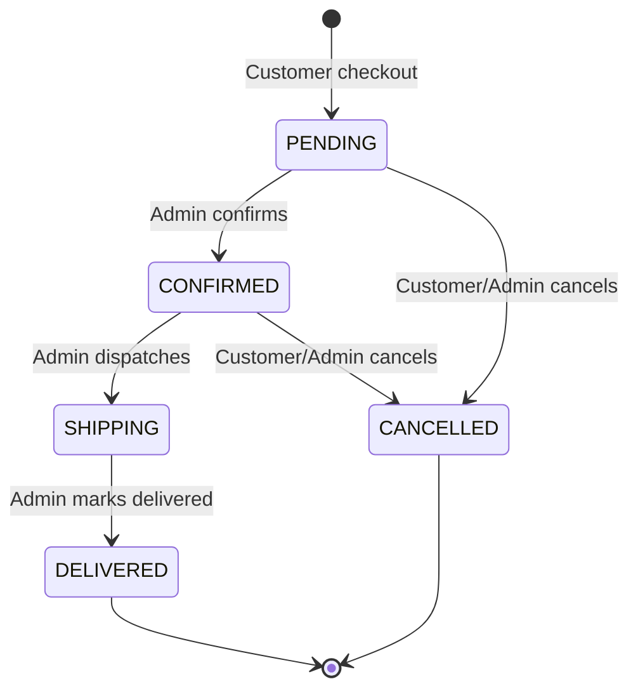

# BOOKHUB — PROJECT PLAN & SOFTWARE REQUIREMENTS SPECIFICATION

> **Dự án:** BookHub — Website bán sách online  
> **Môn học:** PRJ301  
> **Phiên bản tài liệu:** 1.0  
> **Ngày lập:** 23/11/2026  
> **Ngôn ngữ:** Tiếng Việt  
> **Quy mô:** MVP vừa — đáp ứng các nhóm tiêu chí PRJ301 mà không phát triển thành marketplace lớn.

## Mục lục

1. Tổng quan dự án
2. Mục tiêu và tiêu chí thành công
3. Phạm vi dự án
4. Đối chiếu yêu cầu PRJ301
5. Project Context
6. Stakeholders, Actors và phân quyền
7. Use Case Model
8. Functional Requirements
9. Non-Functional Requirements
10. User Stories
11. Swimlane Diagrams
12. Screen Flow
13. Screen Requirements
14. Technology Stack
15. Architecture và Coding Rules
16. Project Structure
17. Database Design
18. Business Rules
19. Statistics & Reporting
20. Project Plan
21. Test Plan
22. Risks, Assumptions và Decisions
23. Deliverables
24. Definition of Done
25. Tài liệu tham chiếu

---

# 1. Tổng quan dự án

## 1.1. Giới thiệu

BookHub là website bán sách trực tuyến quy mô vừa. Khách truy cập có thể xem danh mục sách, tìm kiếm, lọc, sắp xếp, xem chi tiết và tham khảo đánh giá/hỏi đáp. Khách hàng có tài khoản có thể quản lý giỏ hàng, đặt hàng, theo dõi đơn hàng, viết đánh giá và đặt câu hỏi về sách. Quản trị viên quản lý sách, danh mục, tài khoản, đơn hàng, đánh giá, câu hỏi và báo cáo thống kê.

Hệ thống được xây dựng dưới dạng Java Web Application theo mô hình MVC và phân lớp. Giao diện sử dụng JSP kết hợp JSTL/EL; backend sử dụng Servlet, Service, Repository/DAO và JPA do Hibernate triển khai; dữ liệu được lưu trong Microsoft SQL Server.

## 1.2. Product Vision

> Cung cấp một website bán sách đơn giản, dễ sử dụng, cho phép khách hàng tìm được sách phù hợp, đặt mua thuận tiện và tương tác với cửa hàng thông qua đánh giá và hỏi đáp; đồng thời cung cấp cho quản trị viên các công cụ quản lý và thống kê cần thiết.

## 1.3. Tóm tắt sản phẩm

| Thuộc tính | Mô tả |
|---|---|
| Tên hệ thống | BookHub |
| Loại hệ thống | Website bán sách online — single-store e-commerce |
| Actors | Guest, Customer, Admin |
| Giao diện | JSP + JSTL/EL + Bootstrap |
| Backend | Java 17, Jakarta Servlet, Service Layer, JPA/Hibernate |
| Database | Microsoft SQL Server |
| IDE/Build | NetBeans 17, Ant Web Application |
| Web server | Apache Tomcat 10.1.x |
| Thanh toán MVP | COD (thanh toán khi nhận hàng) |
| Phí ship MVP | 30.000 VND/đơn |
| Ngôn ngữ/tiền tệ | Tiếng Việt / VND |
| Kiến trúc triển khai | Một ứng dụng web, một database, một cửa hàng |

## 1.4. Thuật ngữ

| Thuật ngữ | Ý nghĩa |
|---|---|
| Guest | Người chưa đăng nhập |
| Customer | Khách hàng đã đăng ký và đăng nhập |
| Admin | Quản trị viên hệ thống |
| Book | Sản phẩm sách |
| Cart | Giỏ hàng của Customer |
| Order | Đơn đặt hàng |
| Order Item | Một dòng sách và số lượng trong đơn hàng |
| Review | Đánh giá sao và nhận xét về sách |
| Question / Answer | Câu hỏi / câu trả lời về sách |
| JPA | Jakarta Persistence API — chuẩn persistence/ORM |
| JSTL | Jakarta Standard Tag Library — tag library dùng trong JSP |
| PRG | Post/Redirect/Get — tránh submit lại form khi refresh |
| MVP | Phiên bản tối thiểu có thể chạy và nghiệm thu |

# 2. Mục tiêu và tiêu chí thành công

## 2.1. Mục tiêu nghiệp vụ

- Khách tìm và xem thông tin sách mà không cần đăng nhập.
- Khách hàng đặt sách qua giỏ hàng và checkout.
- Khách hàng theo dõi đơn và xem trạng thái xử lý.
- Có tương tác cơ bản qua review và Q&A theo từng cuốn sách.
- Admin quản lý dữ liệu nền và nghiệp vụ bán hàng.
- Có báo cáo sử dụng `MAX`, `MIN`, `AVG`, `SUM`, `COUNT`.

## 2.2. Mục tiêu kỹ thuật

- SQL Server là nguồn dữ liệu chính.
- Truy cập dữ liệu bằng JPA; Hibernate là implementation. Không triển khai DAO bằng JDBC thuần.
- Dùng MVC và phân tách Controller, Service, Repository, Entity, View.
- JSP chỉ hiển thị dữ liệu bằng EL/JSTL; không viết Java scriptlet trong JSP.
- Có validation client-side và server-side; server-side là lớp kiểm tra có thẩm quyền.
- Có authorization tại backend, không chỉ ẩn nút trên giao diện.
- Build/deploy local bằng NetBeans 17 + JDK 17 + Tomcat 10.1.x.

## 2.3. Tiêu chí thành công đo được

| ID | Tiêu chí | Điều kiện đạt |
|---|---|---|
| SC-01 | Khởi chạy | Deploy WAR lên Tomcat, truy cập được Home |
| SC-02 | Database | Hibernate/JPA đọc và ghi SQL Server được |
| SC-03 | Authentication | Register, Login, Logout, Forgot/Reset hoạt động |
| SC-04 | Authorization | Customer không truy cập URL quản trị |
| SC-05 | Catalog | Search, filter, sort, pagination, detail hoạt động |
| SC-06 | Cart | Add, update, remove, total đúng |
| SC-07 | Order | Tạo đơn, snapshot giá, cập nhật stock/status đúng |
| SC-08 | CRUD | Admin tạo/sửa/ẩn sách và danh mục được |
| SC-09 | Review | Customer đủ điều kiện đánh giá sách đã nhận |
| SC-10 | Q&A | Customer hỏi; Admin trả lời; hiển thị theo trạng thái |
| SC-11 | Statistics | Có Count, Sum, Average, Max, Min thực tế |
| SC-12 | JSTL | JSP trong views không chứa scriptlet Java |
| SC-13 | Documentation | Có README, DB scripts, requirements và test checklist |

# 3. Phạm vi dự án

## 3.1. In Scope — MVP

### A. Public Catalog
- Home hiển thị sách nổi bật, sách mới và sách bán chạy.
- Danh sách sách có phân trang.
- Tìm theo tên sách, tác giả hoặc ISBN.
- Lọc theo danh mục và khoảng giá.
- Sort: mới nhất, giá tăng, giá giảm, tên A–Z, bán chạy.
- Chi tiết sách: ảnh bìa, tên, tác giả, nhà xuất bản, ISBN, giá, mô tả, tồn kho, rating.
- Gợi ý sách tương tự theo cùng danh mục.
- Hiển thị review đã duyệt và Q&A không bị ẩn.

### B. Authentication & Account
- Đăng ký Customer; đăng nhập/đăng xuất.
- Quên và đặt lại mật khẩu bằng token có thời hạn.
- Cập nhật tên, số điện thoại; đổi password.
- Role `ADMIN` và `CUSTOMER`; kiểm tra quyền ở Filter/Controller/Service.

### C. Cart & Order
- Một cart đang hoạt động cho mỗi Customer.
- Thêm sách, sửa số lượng, xóa dòng.
- Tính subtotal, phí ship và total.
- Checkout gồm người nhận, số điện thoại, địa chỉ, ghi chú.
- Tạo đơn COD; xem danh sách/chi tiết đơn.
- Customer hủy đơn trước trạng thái `SHIPPING`.
- Admin cập nhật trạng thái đơn.
- Checkout kiểm tra tồn kho và cập nhật tồn kho trong transaction.

### D. Review & Q&A
- Customer chỉ review sách đã mua và đã giao.
- Mỗi Customer tối đa một review cho mỗi Book trong MVP; không hỗ trợ chỉnh sửa sau khi gửi để giữ luồng duyệt đơn giản.
- Review mới chờ Admin duyệt.
- Customer đặt câu hỏi theo Book; Admin trả lời.
- Question có trạng thái `OPEN`, `ANSWERED`, `HIDDEN`.

### E. Admin
- Dashboard thống kê.
- CRUD sách; tạo/sửa/ẩn danh mục.
- Xem và quản lý đơn hàng.
- Xem, khóa/mở khóa Customer.
- Duyệt/ẩn review; trả lời/ẩn Question.

## 3.2. Out of Scope

Để không phình dự án, MVP không làm:
- Payment gateway (VNPay, MoMo, ZaloPay, Stripe).
- Marketplace nhiều người bán, Seller/ Shipper Portal.
- Kết nối đơn vị vận chuyển hoặc tracking real-time.
- Voucher, coupon, điểm thưởng, membership, flash sale.
- Chat real-time, mobile app, public REST API, microservices.
- Quản lý nhiều kho, nhà cung cấp, nhập hàng/POS.
- Recommendation AI/ML.
- Đăng nhập Google/Facebook.
- Upload file ảnh tùy ý; ảnh bìa dùng URL hoặc assets có sẵn.
- Email marketing/notification phức tạp và đa ngôn ngữ.

## 3.3. Giả định nghiệp vụ

1. BookHub đại diện cho **một cửa hàng duy nhất**, không có seller khác nhau.
2. Giá được tính bằng VND; thanh toán MVP là COD.
3. Phí vận chuyển cố định 30.000 VND/đơn; không tính theo vùng/khối lượng.
4. Customer phải đăng nhập mới được dùng Cart/Checkout.
5. Guest được xem catalog, review và Q&A công khai.
6. Chỉ Admin quản lý Book/Category.
7. Chỉ Admin trả lời Q&A trong MVP; không triển khai trả lời ngang hàng Customer-Customer.
8. Review yêu cầu Order có Book tương ứng ở trạng thái `DELIVERED`.
9. Không xóa vật lý Book/Category/User đã có dữ liệu liên quan; dùng deactivate/lock.
10. Múi giờ nghiệp vụ `Asia/Ho_Chi_Minh`.
11. Checkout trừ stock trong cùng transaction tạo đơn; hủy hợp lệ hoàn stock đúng một lần.

# 4. Đối chiếu yêu cầu PRJ301

Đối chiếu trực tiếp tài liệu `Assignment_Loan.pdf` (2 trang) do người dùng cung cấp. Đề yêu cầu Java Web, SQL Server, JPA và không dùng JDBC thuần; các nhóm chấm gồm Authentication, Home/Data Display, CRUD, Statistics, Cart, Framework và Q&A.

| Mục đề | Yêu cầu | BookHub đáp ứng | Bằng chứng kiểm thử |
|---|---|---|---|
| 1 — Mục tiêu | Java Web, backend chuẩn hóa, SQL Server, JPA, không JDBC thuần | Servlet MVC + Service + Repository + JPA/Hibernate + SQL Server | Persistence config, Entity, JPA CRUD |
| 3.1 — 1.0 điểm | Register, Login, Logout, Forgot/Reset, cập nhật tài khoản, role/permission | Auth module, ADMIN/CUSTOMER | Test auth và truy cập trái quyền |
| 3.2 — 2.0 điểm | Home, nhóm dữ liệu, search, filter, sort, paging, detail, similar | Home, Catalog, Book Detail | Test query, filter, sort, page và related books |
| 3.3 — 2.0 điểm | CRUD thực thể chính | CRUD Book/Category; quản trị Order/Review/Q&A theo trạng thái | Test Create/Read/Update/Deactivate |
| 3.5 — 1.0 điểm | MAX, MIN, AVG, SUM, COUNT | Dashboard doanh thu, đơn, giá, tồn kho | Đối chiếu aggregate với DB |
| 3.6 — 1.0 điểm | Cart add/update/remove/total | Cart lưu trong database theo Customer | Test từng thao tác và total |
| 3.7 — 1.0 điểm | Framework, ưu tiên Spring Data JPA hoặc Hibernate/JPA thuần | Hibernate triển khai Jakarta Persistence | EntityManager, JPQL, transaction |
| 3.8 — 2.0 điểm | Q&A: đặt, trả lời, duyệt, quản lý | Customer hỏi, Admin trả lời/ẩn | Test create, answer, hide |

> Đề gốc nhảy số từ mục 3.3 sang 3.5. Tài liệu giữ nguyên cách đánh số của đề.

# 5. Project Context — Bối cảnh hệ thống

## 5.1. Business Context

Cửa hàng sách cần kênh bán trực tuyến để khách xem sách, tìm theo nhu cầu, đặt mua và theo dõi đơn. Cửa hàng cần khu vực quản trị để cập nhật sách/danh mục, xử lý đơn và kiểm duyệt nội dung khách tạo ra.

BookHub giải quyết các vấn đề: khách tự xem thông tin/giá; tìm sách qua category/filter; đặt mua bằng cart/checkout; tham khảo review/Q&A; Admin quản lý và thống kê trong một khu vực.

## 5.2. System Context Diagram



## 5.3. System Boundary

**Trong hệ thống:** auth, catalog, cart, checkout, order, review, Q&A, admin management, reporting, persistence.  
**Ngoài hệ thống:** payment gateway, nhà vận chuyển, nhà cung cấp sách, ERP/POS, email service thực tế khi demo local.

## 5.4. Input / Process / Output

| Nhóm | Nội dung |
|---|---|
| Input | Keyword, category, price range, đăng ký/đăng nhập, cart quantity, địa chỉ nhận hàng, review, question, dữ liệu Admin |
| Process | Validate, authorization, JPA query, tính tiền, kiểm tra stock, transaction, cập nhật status, aggregate thống kê |
| Output | Catalog, Book Detail, Cart, Order Confirmation, Order History, review/Q&A, dashboard, thông báo lỗi/thành công |

# 6. Stakeholders, Actors và phân quyền

## 6.1. Stakeholders

| Stakeholder | Mối quan tâm | Trách nhiệm/Quyền |
|---|---|---|
| Khách truy cập | Xem và tìm sách | Browse không cần tài khoản |
| Khách hàng | Mua sách, theo dõi đơn, review, hỏi đáp | Customer features |
| Quản trị viên | Quản lý dữ liệu, đơn, nội dung, thống kê | Admin Console |
| Chủ cửa hàng | Theo dõi hoạt động kinh doanh | Trong MVP sử dụng tài khoản Admin |
| Developer/Tester | Phát triển và kiểm thử | Quản lý môi trường local/test data |

## 6.2. Actors

### ACT-01 — Guest

Người chưa đăng nhập. Có thể truy cập Home, Catalog, Book Detail, xem review/Q&A công khai, search và filter. Muốn mua hoặc tương tác phải đăng nhập/đăng ký.

### ACT-02 — Customer

Role `CUSTOMER`. Kế thừa quyền Guest; có Cart, Checkout, xem/hủy đơn hợp lệ, review, đặt câu hỏi, cập nhật profile và đổi password.

### ACT-03 — Admin

Role `ADMIN`. Truy cập Admin Dashboard; quản lý Book, Category, User, Order, Review, Q&A và reports. Không được đăng ký Admin bằng form public.

## 6.3. Permission Matrix

Ký hiệu: `V` xem; `C` tạo; `U` cập nhật; `D` xóa/ẩn; `M` quản trị.

| Resource / Action | Guest | Customer | Admin |
|---|:---:|:---:|:---:|
| Home/Catalog/Book Detail | V | V | V |
| Search/Filter/Sort/Paging | V | V | V |
| Review/Q&A công khai | V | V | V |
| Register | C | — | — |
| Login/Logout | Login | Logout | Logout |
| Profile | — | U (của mình) | U (của mình) |
| Cart | — | V/C/U/D | — |
| Checkout | — | C | — |
| Xem Order | — | V (của mình) | V (tất cả) |
| Cancel Order | — | U (đơn mình, khi hợp lệ) | U theo rule |
| Review | — | C/U (đủ điều kiện) | Moderate |
| Question | — | C | V/U/D |
| Answer | — | V | C/U |
| CRUD Book/Category | — | — | M |
| Manage Users/Orders | — | — | M |
| Manage Reviews/Q&A | — | — | M |
| Dashboard/Reports | — | — | V |

## 6.4. Authorization Rules

- Mọi endpoint `/admin/*` được bảo vệ bởi AdminFilter hoặc cơ chế tương đương.
- Endpoint yêu cầu Customer phải kiểm tra session và role tại backend.
- Khi Customer xem/sửa/hủy Order, backend kiểm tra Order thuộc `currentUser.id`; không tin `userId` từ form.
- Khi Customer sửa Review/Question, backend kiểm tra chủ sở hữu bản ghi.
- Không cho phép sửa `role_id` từ profile form.
- Ẩn menu/nút trên giao diện không thay thế authorization ở server.

## 7. Use Case Model

### 7.1. Actors

| Actor | Mô tả | Phạm vi |
|---|---|---|
| Guest | Người chưa đăng nhập | Xem/tìm sách, đăng ký, đăng nhập |
| Customer | Khách hàng đã đăng nhập | Toàn bộ quyền Guest và giỏ hàng, đặt hàng, xem đơn, đánh giá, hỏi đáp |
| Admin | Quản trị viên cửa hàng | Quản trị danh mục, sách, đơn, tài khoản, nội dung và báo cáo |
| System | Tác vụ nội bộ | Tạo mã đơn, tính tiền, kiểm tra tồn kho, hết hạn token |

Không có Seller, Shipper hoặc Moderator trong MVP. Admin là người duy nhất được trả lời Q&A và duyệt Review để giảm số vai trò và độ phức tạp.

### 7.2. Use Case Diagram



### 7.3. Use Case Catalogue

| ID | Use case | Primary actor | Preconditions | Main outcome |
|---|---|---|---|---|
| UC-01 | Browse Home | Guest | Website available | Hiển thị nhóm sách từ DB |
| UC-02 | Search/filter/sort books | Guest | Có dữ liệu sách | Danh sách phù hợp tiêu chí |
| UC-03 | View book detail | Guest | Book đang active | Chi tiết, sách tương tự, review/Q&A public |
| UC-04 | Register | Guest | Email chưa tồn tại | Tạo Customer account |
| UC-05 | Login/logout | Guest/Customer/Admin | Tài khoản hợp lệ | Tạo/hủy phiên đăng nhập |
| UC-06 | Reset password | Guest | Email đã đăng ký | Đặt mật khẩu mới qua token hợp lệ |
| UC-07 | Update profile | Customer/Admin | Đã đăng nhập | Lưu thông tin được phép sửa |
| UC-08 | Manage cart | Customer | Đã đăng nhập | Cart được thêm/cập nhật/xóa |
| UC-09 | Checkout COD | Customer | Cart có hàng, địa chỉ hợp lệ | Tạo Order và OrderItems |
| UC-10 | View/cancel order | Customer | Order thuộc người dùng | Xem trạng thái hoặc hủy hợp lệ |
| UC-11 | Write review | Customer | Đã nhận sách, đủ điều kiện | Review ở trạng thái PENDING |
| UC-12 | Ask question | Customer | Đã đăng nhập, Book active | Question ở trạng thái OPEN |
| UC-13 | Manage categories | Admin | Đã đăng nhập Admin | CRUD/activate category |
| UC-14 | Manage books | Admin | Đã đăng nhập Admin | CRUD/activate book và tồn kho |
| UC-15 | Manage orders | Admin | Đã đăng nhập Admin | Cập nhật trạng thái theo luồng |
| UC-16 | Manage users | Admin | Đã đăng nhập Admin | Khóa/mở khóa Customer |
| UC-17 | Moderate reviews/Q&A | Admin | Có nội dung chờ xử lý | Duyệt/ẩn review, trả lời/ẩn question |
| UC-18 | View reports | Admin | Đã đăng nhập Admin | Xem KPI và thống kê |

### 7.4. Detailed Use Case: UC-09 Checkout COD

- **Mục tiêu:** Customer gửi đơn đặt sách với phương thức thanh toán khi nhận hàng.
- **Actor:** Customer.
- **Trigger:** Customer bấm “Đặt hàng”.
- **Preconditions:** Đã đăng nhập; cart không rỗng; các Book còn active; thông tin người nhận, số điện thoại, địa chỉ hợp lệ.
- **Postconditions thành công:** Một Order và các OrderItems được tạo; tồn kho giảm; CartItems được xóa; tổng tiền được lưu tại Order.

**Main flow**

1. Customer mở trang giỏ hàng và nhấn “Tiến hành đặt hàng”.
2. System tải lại Cart từ DB, không lấy giá/số tiền do trình duyệt gửi lên làm dữ liệu chuẩn.
3. System kiểm tra từng Book còn active, số lượng đặt lớn hơn 0 và tồn kho đủ.
4. System hiển thị trang xác nhận gồm danh sách sách, số lượng, giá hiện tại, tạm tính, phí giao hàng và tổng tiền.
5. Customer nhập tên người nhận, số điện thoại, địa chỉ và ghi chú tùy chọn.
6. Customer chọn COD và xác nhận.
7. Server bắt đầu transaction, tải lại giỏ và khóa/kiểm tra tồn kho theo chiến lược nhất quán đã chọn.
8. Server tính lại tiền từ giá DB; tạo Order với trạng thái PENDING.
9. Server tạo OrderItems, sao lưu tên sách và đơn giá tại thời điểm đặt hàng.
10. Server trừ tồn kho; xóa CartItems; commit transaction.
11. Server chuyển hướng đến trang xác nhận đơn hàng, hiển thị mã đơn.

**Alternative / exception flows**

- A1: Cart rỗng → thông báo và điều hướng về danh mục.
- A2: Sách không còn active → không cho đặt, yêu cầu cập nhật giỏ.
- A3: Tồn kho nhỏ hơn số lượng yêu cầu → rollback; hiển thị số lượng còn lại và giữ giỏ để Customer sửa.
- A4: Giá sách thay đổi từ lúc xem giỏ → dùng giá hiện tại trong DB, hiển thị lại xác nhận trước khi tạo đơn hoặc báo người dùng xác nhận lại.
- A5: Thiếu thông tin nhận hàng → validation tại server, không tạo Order.
- A6: Lỗi khi tạo một OrderItem hoặc trừ kho → rollback toàn bộ, không để đơn dở dang.
- A7: Double click / gửi request lặp → áp dụng Post/Redirect/Get và chống tạo đơn trùng ở tầng service; nút submit bị disable chỉ là hỗ trợ UI, không phải cơ chế bảo đảm duy nhất.

### 7.5. Detailed Use Case: UC-14 Manage Books

1. Admin mở danh sách sách.
2. System hiển thị sách theo trang, hỗ trợ tìm theo tiêu đề/tác giả/ISBN, lọc danh mục và trạng thái.
3. Admin chọn Thêm mới hoặc Sửa.
4. Admin nhập tiêu đề, tác giả, danh mục, giá, tồn kho và mô tả.
5. Server validate dữ liệu, kiểm tra category tồn tại/đang hoạt động và ISBN không trùng.
6. Service lưu bằng JPA transaction.
7. System hiển thị thông báo và cập nhật danh sách.
8. Khi Admin chọn ngừng kinh doanh, System chuyển `is_active=false`; không xóa vật lý sách đã có trong OrderItems.

### 7.6. Detailed Use Case: UC-17 Manage Q&A

1. Customer gửi câu hỏi tại trang chi tiết sách.
2. Server tạo Question trạng thái OPEN.
3. Admin mở hàng chờ câu hỏi, lọc OPEN.
4. Admin nhập câu trả lời và gửi.
5. Server tạo Answers record, cập nhật Question thành ANSWERED trong cùng transaction.
6. Câu hỏi và câu trả lời hiển thị công khai trên trang chi tiết sách.
7. Admin có thể ẩn nội dung không phù hợp; nội dung HIDDEN không xuất hiện công khai.

## 8. Functional Requirements (FR)

### 8.1. Authentication and Account (FR-AUTH)

| ID | Requirement | Priority | Acceptance / validation |
|---|---|---|---|
| FR-AUTH-001 | Guest có thể đăng ký bằng họ tên, email, mật khẩu và xác nhận mật khẩu. | Must | Tạo User role CUSTOMER khi dữ liệu hợp lệ. |
| FR-AUTH-002 | Email phải duy nhất, được trim và chuẩn hóa chữ thường. | Must | Email trùng bị từ chối, không tạo bản ghi thứ hai. |
| FR-AUTH-003 | Mật khẩu tối thiểu 8 ký tự, có chữ và số. | Must | Validate phía server; không lưu mật khẩu gốc. |
| FR-AUTH-004 | Mật khẩu phải được hash bằng BCrypt hoặc Argon2 với salt. | Must | DB chỉ lưu password hash. |
| FR-AUTH-005 | Customer/Admin đăng nhập bằng email và mật khẩu. | Must | Thông tin sai trả thông báo chung, không tiết lộ email có tồn tại. |
| FR-AUTH-006 | Người dùng có thể đăng xuất. | Must | Hủy/invalidate session phía server. |
| FR-AUTH-007 | Người dùng có thể yêu cầu đặt lại mật khẩu. | Must | Phản hồi chung để tránh dò email; phát hành token ngẫu nhiên. |
| FR-AUTH-008 | Reset token một lần, hết hạn sau 15 phút. | Must | Token đã dùng/hết hạn không được dùng lại. |
| FR-AUTH-009 | Người dùng đặt mật khẩu mới qua token hợp lệ. | Must | Hash mật khẩu mới; đánh dấu token đã dùng. |
| FR-AUTH-010 | Customer xem/cập nhật tên, điện thoại và thông tin hồ sơ được phép. | Must | Không cho cập nhật role/status qua form hồ sơ. |
| FR-AUTH-011 | Hệ thống phân biệt Guest, Customer, Admin. | Must | Role lấy từ DB/session đã xác thực. |
| FR-AUTH-012 | Admin có thể khóa/mở khóa tài khoản Customer. | Should | Tài khoản LOCKED/DISABLED không đăng nhập được. |
| FR-AUTH-013 | Guest truy cập tài nguyên cần đăng nhập phải được chuyển tới Login. | Must | Sau login có thể quay về trang đích an toàn. |
| FR-AUTH-014 | Mọi endpoint admin phải kiểm tra quyền ở server. | Must | Customer gọi URL admin trực tiếp nhận 403/redirect phù hợp. |
| FR-AUTH-015 | Session ID được đổi sau khi đăng nhập thành công. | Should | Giảm nguy cơ session fixation. |
| FR-AUTH-016 | Customer có thể đổi mật khẩu khi đã đăng nhập bằng cách nhập mật khẩu hiện tại và mật khẩu mới. | Should | Server xác minh mật khẩu hiện tại, validate mật khẩu mới, lưu hash mới và hủy các reset token đang chờ. |

### 8.2. Home, Catalogue and Book Detail (FR-CAT)

| ID | Requirement | Priority | Acceptance / validation |
|---|---|---|---|
| FR-CAT-001 | Trang Home tải dữ liệu sách từ SQL Server thông qua JPA. | Must | Không sử dụng danh sách hard-code làm dữ liệu chính. |
| FR-CAT-002 | Home hiển thị sách nổi bật. | Must | Chỉ lấy Book active và `is_featured=true`. |
| FR-CAT-003 | Home hiển thị sách mới. | Must | Sắp xếp theo `created_at` giảm dần. |
| FR-CAT-004 | Home có nhóm sách bán chạy. | Should | Tính từ số lượng OrderItems thuộc Order DELIVERED. |
| FR-CAT-005 | Khách có thể xem toàn bộ sách đang kinh doanh. | Must | Không hiển thị Book inactive. |
| FR-CAT-006 | Tìm kiếm chung theo tiêu đề, tác giả hoặc ISBN. | Must | Không phân biệt hoa thường; dùng query parameter binding. |
| FR-CAT-007 | Lọc theo Category. | Must | Chỉ hiển thị sách trong danh mục hoạt động. |
| FR-CAT-008 | Lọc theo khoảng giá min/max. | Should | Min không âm; max không nhỏ hơn min. |
| FR-CAT-009 | Sắp xếp theo mới nhất, giá tăng/giảm, tên A-Z và bán chạy. | Must | Sort key được whitelist ở server; bestseller dựa trên Order DELIVERED. |
| FR-CAT-010 | Danh sách sách phải phân trang. | Must | Mặc định 12 item/trang; page ngoài phạm vi xử lý an toàn. |
| FR-CAT-011 | Người dùng xem trang chi tiết Book. | Must | Hiển thị tên, tác giả, giá, tồn kho, mô tả, danh mục, ảnh. |
| FR-CAT-012 | Trang chi tiết hiển thị sách tương tự. | Should | Cùng Category, khác Book hiện tại, active. |
| FR-CAT-013 | Trang chi tiết hiển thị Review đã APPROVED. | Must | Không hiển thị PENDING/HIDDEN. |
| FR-CAT-014 | Trang chi tiết hiển thị Question ANSWERED và nội dung công khai. | Must | Question/Answer HIDDEN không hiển thị. |
| FR-CAT-015 | Hình ảnh bìa dùng URL hoặc ảnh tĩnh trong assets. | Must | MVP không cần upload file; ảnh lỗi có fallback. |
| FR-CAT-016 | Sách hết hàng vẫn được xem. | Must | Hiển thị “Hết hàng”, không cho thêm vào cart. |

### 8.3. Shopping Cart (FR-CART)

| ID | Requirement | Priority | Acceptance / validation |
|---|---|---|---|
| FR-CART-001 | Customer có một Cart gắn với tài khoản. | Must | Tạo cart khi cần; một user tối đa một cart. |
| FR-CART-002 | Customer thêm Book active, còn hàng vào Cart. | Must | Book đã có trong cart thì cộng số lượng. |
| FR-CART-003 | Customer cập nhật quantity của CartItem. | Must | Quantity là số nguyên từ 1 đến tồn kho hiện tại. |
| FR-CART-004 | Customer xóa một CartItem. | Must | Chỉ xóa item thuộc cart của chính user. |
| FR-CART-005 | Customer xóa toàn bộ cart. | Should | Không xóa Order đã tạo. |
| FR-CART-006 | Cart hiển thị giá hiện tại, số lượng và thành tiền dòng. | Must | Thành tiền được tính lại từ DB. |
| FR-CART-007 | Cart hiển thị tổng tạm tính. | Must | Sum(line total), không tính phí giao hàng trước checkout. |
| FR-CART-008 | Cart không cho vượt tồn kho. | Must | Kiểm tra lại ở service, không tin HTML `max`. |
| FR-CART-009 | Guest muốn thêm vào cart phải đăng nhập. | Must | Điều hướng Login, giữ return URL nội bộ an toàn. |
| FR-CART-010 | Mỗi Book xuất hiện tối đa một dòng trong một Cart. | Must | Unique constraint `(cart_id, book_id)`. |

### 8.4. Order and Checkout (FR-ORD)

| ID | Requirement | Priority | Acceptance / validation |
|---|---|---|---|
| FR-ORD-001 | Customer checkout từ Cart. | Must | Chỉ cho checkout khi Cart còn ít nhất một item hợp lệ. |
| FR-ORD-002 | Checkout yêu cầu tên người nhận, số điện thoại và địa chỉ. | Must | Validate dữ liệu phía server. |
| FR-ORD-003 | Phương thức thanh toán MVP là COD. | Must | Không có thanh toán online trong MVP. |
| FR-ORD-004 | Phí giao hàng mặc định 30.000 VND/đơn. | Must | Lưu snapshot trong Order; có thể đổi sau qua cấu hình. |
| FR-ORD-005 | System tính subtotal, shipping fee và total ở server. | Must | Không nhận giá/tổng tiền do client gửi làm giá trị chuẩn. |
| FR-ORD-006 | Đơn có mã `BH-YYYYMMDD-xxxxx` hoặc mã duy nhất tương đương. | Must | Có unique constraint; không dựa vào mã hiển thị đơn thuần. |
| FR-ORD-007 | Order lưu snapshot tên sách và đơn giá trong OrderItems. | Must | Đổi tên/giá Book về sau không đổi lịch sử đơn. |
| FR-ORD-008 | Checkout tạo Order và OrderItems trong một transaction. | Must | Lỗi giữa chừng phải rollback toàn bộ. |
| FR-ORD-009 | Checkout kiểm tra tồn kho lần cuối và trừ kho nguyên tử. | Must | Không cho stock âm khi có hai checkout đồng thời. |
| FR-ORD-010 | Checkout thành công xóa CartItems của cart tương ứng. | Must | Cart rỗng sau khi tạo Order thành công. |
| FR-ORD-011 | Customer xem danh sách đơn của chính mình. | Must | Phân trang, sắp xếp mới nhất. |
| FR-ORD-012 | Customer xem chi tiết đơn của chính mình. | Must | Không truy cập đơn người khác bằng cách đổi ID. |
| FR-ORD-013 | Customer được hủy Order PENDING hoặc CONFIRMED. | Should | Chuyển trạng thái CANCELLED và hoàn tồn kho đúng một lần. |
| FR-ORD-014 | Admin cập nhật trạng thái theo luồng cho phép. | Must | Không được nhảy trạng thái bất hợp lệ. |
| FR-ORD-015 | Customer xem được trạng thái và mốc thời gian cập nhật đơn. | Should | Hiển thị trạng thái hiện tại, không yêu cầu tracking đơn vị vận chuyển. |

### 8.5. Reviews (FR-REV)

| ID | Requirement | Priority | Acceptance / validation |
|---|---|---|---|
| FR-REV-001 | Customer đủ điều kiện có thể gửi đánh giá Book. | Must | Có Order DELIVERED chứa Book đó. |
| FR-REV-002 | Rating nằm trong khoảng 1–5. | Must | Validate phía server và constraint DB. |
| FR-REV-003 | Một Customer chỉ có một Review cho một Book trong MVP. | Must | Unique `(user_id, book_id)`. |
| FR-REV-004 | Review mới có trạng thái PENDING. | Must | Chưa được hiển thị công khai. |
| FR-REV-005 | Admin có thể APPROVE hoặc HIDE Review. | Must | Ghi nhận trạng thái cập nhật. |
| FR-REV-006 | Trang Book chỉ tính điểm trung bình từ Review APPROVED. | Must | Không tính PENDING/HIDDEN. |
| FR-REV-007 | Review phải có nội dung không vượt giới hạn và được encode khi render. | Must | Chống XSS stored. |

### 8.6. Question and Answer (FR-QA)

| ID | Requirement | Priority | Acceptance / validation |
|---|---|---|---|
| FR-QA-001 | Customer gửi câu hỏi về một Book. | Must | Question gắn Book và user, trạng thái OPEN. |
| FR-QA-002 | Question có tiêu đề và nội dung. | Must | Tiêu đề tối đa 150 ký tự, nội dung tối đa 1.500 ký tự. |
| FR-QA-003 | Admin xem danh sách câu hỏi, lọc OPEN/ANSWERED/HIDDEN. | Must | Có phân trang. |
| FR-QA-004 | Admin trả lời câu hỏi OPEN. | Must | Lưu Answer và chuyển Question sang ANSWERED. |
| FR-QA-005 | Một Question chỉ có tối đa một Answer trong MVP. | Must | Unique `question_id`. |
| FR-QA-006 | Admin có thể ẩn Question không phù hợp. | Must | Chuyển HIDDEN, không hiện public. |
| FR-QA-007 | Guest/Customer xem Q&A đã trả lời và công khai. | Must | Không hiển thị câu hỏi chưa trả lời nếu cấu hình chỉ public answered. |
| FR-QA-008 | Nội dung Q&A được encode đầu ra. | Must | Không render HTML do người dùng tự nhập. |
| FR-QA-009 | Trong MVP, chỉ Admin có quyền trả lời. | Must | Không xây hệ thống seller/moderator. |

### 8.7. Administration and Reporting (FR-ADM)

| ID | Requirement | Priority | Acceptance / validation |
|---|---|---|---|
| FR-ADM-001 | Admin xem dashboard tổng quan. | Must | Hiển thị số sách, đơn, user và doanh thu. |
| FR-ADM-002 | Admin CRUD Category. | Must | Không xóa category đang được Book tham chiếu; cho phép deactivate. |
| FR-ADM-003 | Admin CRUD Book. | Must | Validate ISBN, giá, stock, category. |
| FR-ADM-004 | Admin tìm kiếm/lọc/phân trang Book trong quản trị. | Should | Không tải toàn bộ dữ liệu một lần. |
| FR-ADM-005 | Admin xem danh sách Order. | Must | Tìm theo mã đơn, lọc trạng thái/khoảng ngày. |
| FR-ADM-006 | Admin xem chi tiết Order. | Must | Có recipient, items snapshot, totals, status. |
| FR-ADM-007 | Admin cập nhật trạng thái Order. | Must | Tuân theo state transition và audit thời gian. |
| FR-ADM-008 | Admin xem và khóa/mở khóa Customer. | Should | Không tự khóa tài khoản Admin cuối cùng. |
| FR-ADM-009 | Admin duyệt/ẩn Review. | Must | Chỉ trạng thái APPROVED được public. |
| FR-ADM-010 | Admin trả lời/ẩn Question. | Must | Cập nhật Question và Answer đúng transaction. |
| FR-ADM-011 | Báo cáo số lượng đơn theo trạng thái (COUNT). | Must | Kết quả phù hợp bộ lọc ngày. |
| FR-ADM-012 | Báo cáo doanh thu đơn đã giao (SUM). | Must | Chỉ cộng Order DELIVERED. |
| FR-ADM-013 | Báo cáo giá sách thấp nhất/cao nhất/trung bình (MIN/MAX/AVG). | Must | Chỉ tính sách active hoặc ghi rõ phạm vi. |
| FR-ADM-014 | Báo cáo số lượng sách tồn (SUM stock). | Should | Hiển thị tổng số bản còn trong kho. |
| FR-ADM-015 | Báo cáo sách bán chạy (SUM quantity). | Should | Chỉ tính Order DELIVERED. |

### 8.8. Validation, Error Handling and Navigation (FR-VAL)

- **FR-VAL-001:** Mọi dữ liệu từ form phải được validate tại server, kể cả khi đã có HTML validation.
- **FR-VAL-002:** Các query tìm kiếm/lọc dùng parameter binding của JPA; không nối chuỗi đầu vào trực tiếp vào JPQL/SQL.
- **FR-VAL-003:** Các thao tác thay đổi dữ liệu dùng POST; GET chỉ đọc dữ liệu.
- **FR-VAL-004:** Sau POST thành công dùng Post/Redirect/Get (PRG) để tránh submit lại khi refresh.
- **FR-VAL-005:** Lỗi validation hiển thị gần field tương ứng; lỗi hệ thống hiển thị thông báo thân thiện.
- **FR-VAL-006:** Không hiển thị stack trace, SQL, password hash hoặc cấu hình nội bộ cho người dùng.
- **FR-VAL-007:** Trang 403, 404 và 500 có giao diện thống nhất.
- **FR-VAL-008:** Mọi nội dung người dùng nhập khi hiển thị phải được output encode; không cho render HTML tùy ý.

## 9. Non-Functional Requirements (NFR)

| ID | Quality attribute | Requirement / target | Verification |
|---|---|---|---|
| NFR-PERF-001 | Performance | Trang Home/catalog/detail mục tiêu tải dưới 3 giây trên môi trường demo với 1.000 sách và 20 người dùng đồng thời trong điều kiện mạng nội bộ. | Đo thử và ghi nhận môi trường đo. |
| NFR-PERF-002 | Performance | Truy vấn danh sách phải phân trang tại DB; không load tất cả Books rồi mới cắt trang trong Java. | Review repository/query. |
| NFR-PERF-003 | Performance | Thông tin Home dùng số truy vấn hợp lý, tránh N+1 khi hiển thị card sách. | SQL log/profile thử. |
| NFR-SEC-001 | Security | Mật khẩu được hash bằng BCrypt/Argon2; không log hoặc hiển thị password. | Kiểm tra DB và log. |
| NFR-SEC-002 | Security | Chống SQL/JPQL injection bằng parameter binding và sort whitelist. | Code review/test payload. |
| NFR-SEC-003 | Security | Phân quyền được thực hiện tại server cho mọi endpoint protected. | Test truy cập trực tiếp URL. |
| NFR-SEC-004 | Security | Output encoding cho dữ liệu user để hạn chế XSS. | Test nội dung script trong review/Q&A. |
| NFR-SEC-005 | Security | Form thay đổi dữ liệu có CSRF token hoặc cơ chế CSRF tương đương. | Test request thiếu/sai token. |
| NFR-SEC-006 | Security | Session cookie dùng HttpOnly; bật Secure khi triển khai HTTPS; SameSite phù hợp. | Kiểm tra response cookie. |
| NFR-SEC-007 | Security | Không để mật khẩu DB trong Git public hoặc source code view; tách config môi trường. | Kiểm tra repository. |
| NFR-SEC-008 | Security | Lỗi không tiết lộ stack trace, SQL, token reset hoặc thông tin nội bộ. | Kiểm tra trang lỗi/log. |
| NFR-DATA-001 | Integrity | Dùng PK/FK, UNIQUE, CHECK và NOT NULL phù hợp. | Chạy bộ test constraint. |
| NFR-DATA-002 | Integrity | Checkout tạo Order, OrderItems và trừ stock trong một transaction. | Test rollback lỗi mô phỏng. |
| NFR-DATA-003 | Integrity | Stock không được nhỏ hơn 0, kể cả khi có checkout đồng thời. | Test nhiều request đồng thời. |
| NFR-DATA-004 | Integrity | Lịch sử Order lưu snapshot tên và giá tại thời điểm mua. | Sửa Book sau khi đặt và kiểm tra Order. |
| NFR-DATA-005 | Integrity | Hạn chế hard-delete đối với dữ liệu đã tham chiếu lịch sử. | Kiểm tra FK và service. |
| NFR-USE-001 | Usability | Giao diện responsive cho desktop, tablet và mobile. | Kiểm tra các viewport phổ biến. |
| NFR-USE-002 | Usability | Form có label, trạng thái lỗi, thông báo thành công và xác nhận hành động nhạy cảm. | Kiểm thử thủ công. |
| NFR-USE-003 | Usability | Ngôn ngữ giao diện thống nhất tiếng Việt; giá hiển thị VND. | UI review. |
| NFR-USE-004 | Usability | Giỏ hàng, đơn hàng và lỗi tồn kho có thông báo dễ hiểu. | Kiểm thử với người dùng. |
| NFR-MAINT-001 | Maintainability | Phân lớp Controller/Service/Repository/Entity/View; tránh nghiệp vụ trong Servlet/JSP. | Code review. |
| NFR-MAINT-002 | Maintainability | Tên class PascalCase, field/method camelCase, constant UPPER_SNAKE_CASE. | Code review. |
| NFR-MAINT-003 | Maintainability | Mọi thay đổi schema có file SQL migration/version trong thư mục database. | Kiểm tra Git. |
| NFR-MAINT-004 | Maintainability | Có README hướng dẫn cài đặt, config, seed data và chạy demo. | Người khác làm theo thành công. |
| NFR-COMP-001 | Compatibility | Build/run bằng JDK 17, NetBeans 17, Tomcat 10.1.x. | Test trên môi trường mục tiêu. |
| NFR-COMP-002 | Compatibility | Sử dụng namespace `jakarta.*`; không trộn thư viện `javax.*` cũ. | Kiểm tra dependencies/import. |
| NFR-AVAIL-001 | Availability | MVP chạy trong mạng local/demo; không cam kết SLA production. | Khởi động và smoke test. |
| NFR-BACKUP-001 | Recoverability | Có script tạo schema/seed và hướng dẫn backup/restore SQL Server. | Test dựng lại DB sạch. |
| NFR-TEST-001 | Testability | Business logic nằm trong Service để có thể test độc lập. | Unit/integration test. |

## 10. User Stories and Acceptance Criteria

### 10.1. Guest

**US-G-01 – Xem danh sách sách**  
Là Guest, tôi muốn xem các sách đang bán để tìm được cuốn phù hợp.  
Acceptance criteria:
- Home hiển thị sách nổi bật, sách mới và đường dẫn tới danh mục.
- Chỉ sách active xuất hiện.
- Mỗi card có bìa, tên, tác giả, giá và trạng thái tồn kho.

**US-G-02 – Tìm kiếm và lọc sách**  
Là Guest, tôi muốn tìm theo tên/tác giả, lọc danh mục và khoảng giá để thu hẹp kết quả.  
Acceptance criteria:
- Tìm kiếm không phân biệt chữ hoa/thường.
- Bộ lọc được giữ khi chuyển trang.
- Sort chỉ nhận các lựa chọn hợp lệ.
- Kết quả phân trang, mặc định 12 sách/trang.

**US-G-03 – Xem chi tiết sách**  
Là Guest, tôi muốn xem mô tả và thông tin sách trước khi mua.  
Acceptance criteria:
- Trang chi tiết có giá, mô tả, tác giả, danh mục, tồn kho.
- Có sách tương tự cùng danh mục.
- Review và Q&A chưa được duyệt/ẩn không hiển thị.

**US-G-04 – Tạo tài khoản**  
Là Guest, tôi muốn đăng ký để sử dụng giỏ hàng và đặt mua sách.  
Acceptance criteria:
- Email trùng bị từ chối.
- Password được hash.
- Tài khoản mới mặc định role CUSTOMER.

**US-G-05 – Đặt lại mật khẩu**  
Là Guest quên mật khẩu, tôi muốn đặt mật khẩu mới an toàn.  
Acceptance criteria:
- Có thông báo phản hồi chung.
- Token hết hạn sau 15 phút và chỉ sử dụng một lần.
- Token sai/hết hạn không thể thay đổi mật khẩu.

### 10.2. Customer

**US-C-01 – Quản lý thông tin cá nhân**  
Là Customer, tôi muốn cập nhật tên và số điện thoại.  
Acceptance criteria:
- Server chỉ cho cập nhật field được phép.
- Email/role/status không bị thay đổi qua form profile.

**US-C-02 – Thêm sách vào giỏ**  
Là Customer, tôi muốn thêm sách và điều chỉnh số lượng trước khi checkout.  
Acceptance criteria:
- Không thêm sách inactive/hết hàng.
- Không vượt số lượng tồn kho.
- Thêm cùng một sách sẽ cập nhật dòng cũ, không tạo dòng trùng.
- Tổng tiền thay đổi đúng theo giá DB.

**US-C-03 – Đặt hàng COD**  
Là Customer, tôi muốn đặt sách và thanh toán khi nhận hàng.  
Acceptance criteria:
- Phải có người nhận, số điện thoại, địa chỉ.
- Hệ thống tự tính phí giao 30.000 VND và tổng đơn.
- Đơn và chi tiết đơn được lưu đầy đủ; stock giảm trong cùng transaction.
- Giỏ rỗng sau khi đặt thành công.

**US-C-04 – Theo dõi đơn hàng**  
Là Customer, tôi muốn xem trạng thái các đơn đã đặt.  
Acceptance criteria:
- Chỉ xem được đơn của bản thân.
- Hiển thị mã đơn, ngày tạo, tổng tiền, trạng thái và chi tiết sách.

**US-C-05 – Hủy đơn đủ điều kiện**  
Là Customer, tôi muốn hủy đơn chưa chuyển sang giao hàng.  
Acceptance criteria:
- Chỉ PENDING/CONFIRMED được hủy.
- Khi hủy, stock được hoàn đúng một lần.
- Đơn đã SHIPPING/DELIVERED/CANCELLED không được hủy bằng chức năng Customer.

**US-C-06 – Đánh giá sách đã mua**  
Là Customer, tôi muốn đánh giá sách đã nhận.  
Acceptance criteria:
- Chỉ được review sách trong Order DELIVERED.
- Rating 1–5; mỗi user một review/book.
- Review mới ở PENDING và chỉ công khai sau khi Admin duyệt.

**US-C-07 – Đặt câu hỏi về sách**  
Là Customer, tôi muốn gửi câu hỏi để được cửa hàng giải đáp.  
Acceptance criteria:
- Question được gắn chính xác với Book và người gửi.
- Mới tạo có status OPEN.
- Sau khi Admin trả lời, câu trả lời hiển thị ở trang chi tiết sách.

### 10.3. Admin

**US-A-01 – Quản lý danh mục**  
Là Admin, tôi muốn thêm/sửa/ngừng danh mục để tổ chức catalogue.  
Acceptance criteria: tên và slug không trùng; không xóa vật lý danh mục đang được dùng; danh mục inactive không dùng cho sách mới.

**US-A-02 – Quản lý sách**  
Là Admin, tôi muốn CRUD sách để cập nhật catalogue.  
Acceptance criteria: validate giá > 0, tồn kho >= 0, category hợp lệ; ISBN không trùng; sách lịch sử đã bán chỉ được deactivate thay vì hard-delete.

**US-A-03 – Quản lý đơn hàng**  
Là Admin, tôi muốn xác nhận và cập nhật trạng thái đơn.  
Acceptance criteria: chỉ chuyển trạng thái theo sơ đồ; hiển thị đầy đủ snapshot đơn; không sửa đơn giá lịch sử.

**US-A-04 – Quản lý khách hàng**  
Là Admin, tôi muốn xem và khóa tài khoản vi phạm.  
Acceptance criteria: có tìm kiếm/phân trang; Admin không thể khóa chính mình hoặc Admin cuối cùng trong hệ thống.

**US-A-05 – Duyệt Review**  
Là Admin, tôi muốn duyệt hoặc ẩn nội dung đánh giá.  
Acceptance criteria: chỉ APPROVED công khai; dashboard ghi nhận số pending.

**US-A-06 – Trả lời Q&A**  
Là Admin, tôi muốn trả lời câu hỏi của khách.  
Acceptance criteria: một câu hỏi tối đa một câu trả lời trong MVP; trả lời chuyển Question sang ANSWERED; có thể ẩn câu hỏi không phù hợp.

**US-A-07 – Xem báo cáo**  
Là Admin, tôi muốn theo dõi doanh thu và hoạt động bán sách.  
Acceptance criteria: có Count đơn, Sum doanh thu đã giao, Min/Max/Avg giá, Sum tồn kho và sách bán chạy; các chỉ số có phạm vi thời gian rõ ràng.

## 11. Swimlane Workflows

### 11.1. Swimlane – Checkout COD



### 11.2. Swimlane – Admin Create/Update Book



### 11.3. Swimlane – Review Moderation



### 11.4. Swimlane – Ask and Answer Question



## 12. Screen Flow

### 12.1. Public and Customer Flow



### 12.2. Admin Flow



## 13. Screen Requirements and UI Specification

### 13.1. Screen Inventory

| Screen ID | Screen | Route (gợi ý) | Access | Main actions |
|---|---|---|---|---|
| SCR-01 | Home | `/` | Public | Xem nhóm sách, tìm kiếm, điều hướng |
| SCR-02 | Book catalogue | `/books` | Public | Search/filter/sort/page |
| SCR-03 | Book detail | `/books/detail?id={id}` | Public | Add cart, review list, Q&A list |
| SCR-04 | Register | `/register` | Guest | Tạo tài khoản |
| SCR-05 | Login | `/login` | Guest | Đăng nhập |
| SCR-06 | Forgot password | `/forgot-password` | Guest | Yêu cầu reset |
| SCR-07 | Reset password | `/reset-password?token=...` | Guest | Đặt password mới |
| SCR-08 | Cart | `/cart` | Customer | Update/remove/checkout |
| SCR-09 | Checkout | `/checkout` | Customer | Nhập người nhận và xác nhận COD |
| SCR-10 | Order success | `/orders/success?id={id}` | Customer | Xem mã đơn |
| SCR-11 | My orders | `/account/orders` | Customer | Danh sách/lọc đơn |
| SCR-12 | Order detail | `/account/orders/detail?id={id}` | Customer | Xem và hủy đơn đủ điều kiện |
| SCR-13 | Profile | `/account/profile` | Customer | Cập nhật hồ sơ |
| SCR-14 | Admin dashboard | `/admin` | Admin | KPI, link quản trị |
| SCR-15 | Admin books | `/admin/books` | Admin | Search/list/activate/deactivate |
| SCR-16 | Book form | `/admin/books/form` | Admin | Create/update Book |
| SCR-17 | Admin categories | `/admin/categories` | Admin | CRUD/deactivate Category |
| SCR-18 | Admin orders | `/admin/orders` | Admin | Search/filter/state update |
| SCR-19 | Admin users | `/admin/users` | Admin | Search/lock/unlock |
| SCR-20 | Admin reviews | `/admin/reviews` | Admin | Approve/hide |
| SCR-21 | Admin Q&A | `/admin/questions` | Admin | Answer/hide |
| SCR-22 | Reports | `/admin/reports` | Admin | KPI and aggregate reports |
| SCR-23 | Error pages | `/403`, `/404`, `/500` | Public | Explain error and navigate |

### 13.2. Home Screen (SCR-01)

- Header: BookHub logo, link Home, Danh mục, search bar, account menu, cart count.
- Hero/banner tĩnh (không cần CMS trong MVP).
- Section “Sách nổi bật”: tối đa 8 Book active có `is_featured=true`.
- Section “Sách mới”: 8 Book active sắp theo `created_at DESC`.
- Section “Bán chạy”: tối đa 8 Book dựa trên tổng quantity OrderItems của đơn DELIVERED.
- Category shortcuts; footer có thông tin cửa hàng, chính sách demo và liên hệ.
- Book card gồm cover, title, author, price VND, trạng thái còn hàng/hết hàng, nút xem chi tiết.

### 13.3. Catalogue Screen (SCR-02)

- Search bar; category dropdown; price min/max; sort dropdown.
- Khu kết quả hiển thị số lượng kết quả và active filters.
- Grid 3–4 cột desktop, 2 cột tablet, 1–2 cột mobile tùy breakpoint.
- Pagination có trang trước/sau, trang hiện tại và tổng trang.
- Khi không có kết quả hiển thị empty state và nút xóa bộ lọc.
- URL giữ query string, ví dụ `/books?keyword=java&categoryId=2&minPrice=50000&maxPrice=200000&sort=price_asc&page=1`.

### 13.4. Book Detail Screen (SCR-03)

- Hình bìa, title, author, publisher, ISBN, publish year, category.
- Giá, tồn kho hoặc trạng thái hết hàng.
- Description; nút thêm giỏ (chỉ enable khi active và stock > 0).
- Thông tin rating trung bình từ Reviews APPROVED và danh sách reviews.
- Khu Q&A công khai: câu hỏi answered; Customer đăng câu hỏi trong form riêng.
- Gợi ý sách cùng danh mục, loại trừ sách hiện tại.

### 13.5. Cart and Checkout (SCR-08/09)

- Cart table/list: cover, title, unit price, quantity, line total, remove.
- Tạm tính là tổng các line total; phí giao hàng chỉ hiển thị rõ tại checkout.
- Checkout form: recipient name, phone, shipping address, note (optional), payment method cố định COD.
- Tóm tắt order: từng sách, quantity, unit price, subtotal, shipping fee 30.000 VND, total.
- Không có input cho client tự quyết định giá, phí hoặc tổng.
- Cảnh báo stock/price thay đổi và yêu cầu khách xem lại trước khi xác nhận nếu dữ liệu thay đổi.

### 13.6. Admin Screens

- Admin layout có sidebar: Dashboard, Books, Categories, Orders, Users, Reviews, Q&A, Reports.
- Table list phải có pagination/search/filter; trạng thái rõ ràng; nút destructive phải có confirm.
- Book form: title, author, publisher, ISBN, category, published year, price, stock, short description, description, cover URL, featured, active.
- Order detail phải hiển thị snapshot để Admin xử lý đơn mà không bị ảnh hưởng khi Book được sửa tên/giá.
- Reports có filter date range và giải thích định nghĩa chỉ số.

### 13.7. UI Standards

- Framework giao diện: Bootstrap 5.3.x; CSS riêng cho brand BookHub.
- Font dễ đọc, màu sắc nhất quán, contrast tốt, trạng thái hover/focus/disabled rõ ràng.
- Dùng VND, định dạng ví dụ `125.000 ₫`; thời gian hiển thị theo `dd/MM/yyyy HH:mm`.
- Label liên kết input qua `for/id`; lỗi có text, không chỉ đổi màu.
- Dùng `<c:out>` cho text động; không cho dữ liệu user render HTML raw.
- Tất cả form có CSRF token; thao tác thay đổi dữ liệu dùng POST.

## 14. Technology Stack and Environment Setup

### 14.1. Chốt Tech Stack

| Layer | Technology | Version / selection | Purpose |
|---|---|---|---|
| IDE | Apache NetBeans | 17 | Tạo, build, debug Ant Web Application |
| Language/runtime | Java JDK | 17 LTS | Compile/runtime |
| Build | Apache Ant | NetBeans Ant project | Build WAR, không dùng Maven trong baseline |
| Web server | Apache Tomcat | 10.1.x (10.1.62 được xác minh trên trang tài liệu ngày 23/11/2026) | Servlet/JSP container, Jakarta EE 10 web API subset |
| Web MVC | Jakarta Servlet | 6.0 | Controller, Filter, request/response |
| View | Jakarta Server Pages | 3.1 | JSP templates, chỉ render view |
| Template tags | Jakarta Standard Tag Library | 3.0 | JSTL Core/Formatting/Functions |
| Expression language | Jakarta EL | 5.0 (Tomcat cung cấp) | Đọc view model bằng `${...}` |
| Persistence API | Jakarta Persistence | 3.1 | EntityManager, entity mapping, JPQL |
| ORM | Hibernate ORM | 6.6.x; baseline 6.6.59.Final | JPA provider |
| Database | Microsoft SQL Server | SQL Server 2019/2022 Express/Developer | Database quan hệ |
| DB driver | Microsoft JDBC Driver | 13.6.2.jre11 | Kết nối SQL Server từ Java 17 |
| CSS framework | Bootstrap | 5.3.x | Responsive UI |
| Frontend behavior | Vanilla JavaScript | ES6+ | Tăng/giảm quantity, confirm, validation hỗ trợ |
| Test | JUnit | 5.x | Unit tests/service tests |
| Version control | Git | Current stable | Source control |

**Compatibility decision:** Chọn Tomcat 10.1.x + Servlet 6.0 + JSP 3.1 + JSTL 3.0 + Jakarta Persistence 3.1 + Hibernate 6.6. Không trộn `javax.servlet.*`/`javax.persistence.*` đời cũ với `jakarta.*`. Tomcat 10.1.x triển khai các API Jakarta EE 10 tương ứng; JSTL 3.0 dùng tag URIs `jakarta.tags.*`; Hibernate 6.6 là nhánh phù hợp Java 17/Jakarta Persistence 3.1. Tham khảo tài liệu chính thức ở phần References.

### 14.2. Database Connection Configuration (theo yêu cầu)

| Setting | Value |
|---|---|
| Host | `localhost` |
| Port | `1433` |
| Database | `BookHubDB` |
| Authentication | SQL Server Authentication / Mixed Mode |
| Username | `sa` |
| Password (local development only) | `123` |
| JDBC driver class | `com.microsoft.sqlserver.jdbc.SQLServerDriver` |
| JDBC URL | `jdbc:sqlserver://localhost:1433;databaseName=BookHubDB;encrypt=true;trustServerCertificate=true` |

> **Security warning:** `sa` + `123` là credential yếu, chỉ dùng đúng máy local phục vụ bài tập nếu SQL Server cho phép. Không expose port 1433 ra Internet, không commit password vào Git, không dùng credential này trên server public. Nếu SQL Server password policy từ chối `123`, cần dùng password mạnh hơn thay vì tắt bảo vệ hệ thống. `trustServerCertificate=true` chỉ phù hợp local/dev; môi trường thật phải cấu hình chứng chỉ hợp lệ.

### 14.3. SQL Server Setup Checklist

1. Cài SQL Server 2019/2022 Express hoặc Developer và SQL Server Management Studio.
2. Trong SQL Server Configuration Manager, bật TCP/IP cho instance đang dùng.
3. Vào TCP/IP Properties → IPAll: đặt `TCP Port = 1433`, xóa dynamic port nếu đang sử dụng port cố định.
4. Restart SQL Server service để port có hiệu lực.
5. Bật SQL Server and Windows Authentication Mode (Mixed Mode) nếu dùng SQL login.
6. Enable login `sa` nếu policy môi trường local cho phép; đặt password theo yêu cầu bài tập hoặc password mạnh hơn nếu policy bắt buộc.
7. Mở SSMS bằng SQL Server Authentication, kiểm tra `sa` đăng nhập được.
8. Tạo database `BookHubDB`; chạy `database/01_schema.sql`, sau đó `02_seed.sql`.
9. Kiểm tra TCP listener port 1433 và kết nối JDBC từ ứng dụng.

### 14.4. Dependencies for Ant Project

Đặt các JAR cần thiết trong `web/WEB-INF/lib` hoặc cấu hình Libraries trong NetBeans. Dependency set phải lấy đầy đủ từ release tương ứng và không được trộn major version.

| Library | Artifact / file family | Notes |
|---|---|---|
| Hibernate ORM | `org.hibernate.orm:hibernate-core:6.6.59.Final` | Provider JPA; cần các transitive runtime dependencies đúng release |
| Jakarta Persistence API | `jakarta.persistence:jakarta.persistence-api:3.1.x` | Khớp JPA 3.1; không dùng `javax.persistence-api` |
| Microsoft JDBC | `com.microsoft.sqlserver:mssql-jdbc:13.6.2.jre11` | Variant `jre11` chạy được với Java 17 |
| JSTL API | `jakarta.servlet.jsp.jstl:jakarta.servlet.jsp.jstl-api:3.0.2` | Tag API |
| JSTL implementation | `org.glassfish.web:jakarta.servlet.jsp.jstl:3.0.1` | Runtime tag implementation |
| Password hashing | BCrypt implementation tương thích Java 17, ví dụ jbcrypt 0.4 hoặc BCrypt từ Spring Security Crypto | Chọn một implementation, không lưu plaintext |
| Logging | SLF4J + một provider tương thích | Tránh đưa nhiều logging binding trùng lặp |
| Testing | JUnit 5 jars | Để ở test classpath, không nhất thiết đóng gói vào WAR |

**Không đóng gói trùng các API mà Tomcat đã cung cấp**, gồm Servlet API, JSP API, EL API và các lớp container. Với JSTL, phải có JSTL API và implementation trong ứng dụng nếu Tomcat installation không cung cấp sẵn JSTL. Đọc dependency tree/release notes trước khi copy JAR vào `WEB-INF/lib`; tránh các JAR `javax.*` cũ.

### 14.5. JPA and Hibernate Configuration

- Tạo `META-INF/persistence.xml` trong classpath của ứng dụng.
- Persistence unit ví dụ: `BookHubPU`, transaction type `RESOURCE_LOCAL` cho ứng dụng Servlet chạy trên Tomcat.
- Provider: `org.hibernate.jpa.HibernatePersistenceProvider`.
- Dialect: `org.hibernate.dialect.SQLServerDialect`.
- `hibernate.hbm2ddl.auto=validate` sau khi schema script đã tạo DB; không dùng `create`/`create-drop` trên DB có dữ liệu.
- `hibernate.show_sql` chỉ bật trong development; không bật SQL verbose trong demo production.
- Tạo một `EntityManagerFactory` singleton cho lifecycle ứng dụng; đóng khi `ServletContext` shutdown.
- Mỗi request/service transaction tạo và đóng `EntityManager` theo scope; không share EntityManager giữa thread.
- Transaction bắt đầu/commit/rollback trong Service layer; Repository nhận EntityManager hoặc dùng factory tương ứng.
- JPA được dùng cho CRUD/query. Không triển khai DAO bằng JDBC thuần; không dùng `DriverManager`/`PreparedStatement` trong business repository.
- `persistence.xml` có thể nhận connection properties qua file cấu hình local/environment; không để credential production trong source control.
- Với Ant project, `JpaUtil` đọc `bookhub-local.properties` ở external/local path và truyền overrides vào `Persistence.createEntityManagerFactory("BookHubPU", overrides)`. File local chỉ có trên máy chạy và phải nằm trong `.gitignore`.

Ví dụ file cấu hình local (không commit):

```properties
db.url=jdbc:sqlserver://localhost:1433;databaseName=BookHubDB;encrypt=true;trustServerCertificate=true
db.username=sa
db.password=123
```

Ví dụ cơ chế override JPA lúc bootstrap (skeleton):

```java
Map<String, Object> overrides = new HashMap<>();
overrides.put("jakarta.persistence.jdbc.url", localConfig.getProperty("db.url"));
overrides.put("jakarta.persistence.jdbc.user", localConfig.getProperty("db.username"));
overrides.put("jakarta.persistence.jdbc.password", localConfig.getProperty("db.password"));
EntityManagerFactory emf = Persistence.createEntityManagerFactory("BookHubPU", overrides);
```

Mẫu skeleton (giữ password ở cấu hình local, không commit):

```xml
<persistence xmlns="https://jakarta.ee/xml/ns/persistence" version="3.1">
  <persistence-unit name="BookHubPU" transaction-type="RESOURCE_LOCAL">
    <provider>org.hibernate.jpa.HibernatePersistenceProvider</provider>
    <properties>
      <property name="jakarta.persistence.jdbc.driver"
                value="com.microsoft.sqlserver.jdbc.SQLServerDriver"/>
      <property name="jakarta.persistence.jdbc.url"
                value="jdbc:sqlserver://localhost:1433;databaseName=BookHubDB;encrypt=true;trustServerCertificate=true"/>
      <!-- Inject credentials from a local, uncommitted config in the running app. -->
      <property name="hibernate.dialect" value="org.hibernate.dialect.SQLServerDialect"/>
      <property name="hibernate.hbm2ddl.auto" value="validate"/>
      <property name="hibernate.show_sql" value="false"/>
    </properties>
  </persistence-unit>
</persistence>
```

Trong project Ant, nếu driver/hibernate properties được đặt ở file config ngoài WAR, cần bảo đảm Tomcat process đọc được file đó. Với bài tập local, có thể inject properties bằng code bootstrap từ config file nằm ngoài Git; không hard-code password trong `persistence.xml` đã commit.

### 14.6. JSTL-First JSP Policy (Bắt buộc)

**JSP chỉ là View.** Toàn bộ JSP trong `web/WEB-INF/views/` phải dùng Jakarta JSTL và EL để render dữ liệu do Servlet gửi qua request/session scope. Không được viết JSP thuần theo kiểu Java scriptlet.

Allowed:

```jsp
<%@ page contentType="text/html; charset=UTF-8" pageEncoding="UTF-8" %>
<%@ taglib prefix="c" uri="jakarta.tags.core" %>
<%@ taglib prefix="fmt" uri="jakarta.tags.fmt" %>

<h1><c:out value="${pageTitle}" /></h1>
<c:if test="${not empty books}">
  <div class="row">
    <c:forEach var="book" items="${books}">
      <div class="col-md-3">
        <h2><c:out value="${book.title}" /></h2>
        <p><c:out value="${book.author}" /></p>
        <fmt:formatNumber value="${book.price}" type="number" /> ₫
        <c:url var="detailUrl" value="/books/detail">
          <c:param name="id" value="${book.id}" />
        </c:url>
        <a href="<c:out value='${detailUrl}' />">Chi tiết</a>
      </div>
    </c:forEach>
  </div>
</c:if>
<c:if test="${empty books}">
  <p>Chưa có sách phù hợp.</p>
</c:if>
```

Prohibited:

```jsp
<%-- KHÔNG ĐƯỢC DÙNG: JSP scriptlet / declaration / expression --%>
<% /* Java code in JSP */ %>
<%= request.getAttribute("books") %>
<%! private int count; %>
```

Rules:
- Được phép dùng page directive và taglib directive để khai báo encoding/tag library; không được dùng scriptlet `<%...%>`, expression `<%=...%>`, declaration `<%!...%>`.
- Dùng `<c:if>`, `<c:choose>`, `<c:forEach>`, `<c:out>`, `<c:url>`, `<c:param>`, `<fmt:formatNumber>`, `<fmt:formatDate>` và EL `${...}`.
- Tag URI Jakarta JSTL 3.0: `jakarta.tags.core`, `jakarta.tags.fmt`, `jakarta.tags.functions` (tùy tag library thực sự được dùng).
- Không đặt SQL/JPA/EntityManager/transaction/business calculation trong JSP.
- Không dùng JSTL SQL tags như `<sql:query>`/`<sql:update>`; database access phải qua JPA ở Repository/Service.
- JSP view nên nằm trong `WEB-INF` để không thể gọi trực tiếp bỏ qua Controller.
- Để JSP truy cập DTO/ViewModel thay vì truyền Entity có lazy association chưa được load; chuẩn bị dữ liệu ở Controller/Service.
- Kiểm tra project bằng tìm kiếm `\<%` để phát hiện scriptlet (loại trừ comment hoặc file tài liệu không phải JSP).
- Có thể cấu hình Tomcat/Jakarta Pages từ `web.xml` để compiler từ chối scripting elements trong mọi JSP:

```xml
<jsp-config>
  <jsp-property-group>
    <url-pattern>*.jsp</url-pattern>
    <scripting-invalid>true</scripting-invalid>
  </jsp-property-group>
</jsp-config>
```

Đặt phần `jsp-config` bên trong `web-app` theo đúng schema version của Servlet 6.0. Nhờ vậy, scriptlet bị chặn ngay lúc biên dịch JSP thay vì chỉ dựa vào quy ước code review.

## 15. Application Architecture and Coding Standards

### 15.1. Architecture Overview

Dùng mô hình Layered MVC. Servlet nhận request và điều phối; Service nắm nghiệp vụ/transaction; Repository dùng JPA truy vấn; Entity ánh xạ DB; JSP/JSTL chỉ hiển thị ViewModel.



### 15.2. Layer Responsibilities

| Layer | Responsibilities | Must not do |
|---|---|---|
| Filter | Encoding, session check, role check, CSRF validation | Không viết business transaction |
| Servlet Controller | Đọc request, parse input, gọi Service, set request attributes, forward/redirect | Không chứa JPQL/SQL dài hoặc quy tắc tính tiền |
| Service | Business rules, transaction, ownership check, order state transition | Không render HTML/JSP |
| Repository | CRUD/query bằng JPA/JPQL/Criteria | Không render view hoặc lấy request/session |
| Entity | Mapping table, relationships, basic invariant | Không phụ thuộc Servlet/JSP |
| DTO/ViewModel | Data cần cho View, không lộ entity graph nhạy cảm | Không giữ EntityManager |
| JSP | Render bằng JSTL/EL, form và layout | Không scriptlet, JDBC/JPA, tính nghiệp vụ |

### 15.3. Request Lifecycle

1. Browser gửi HTTP request.
2. CharacterEncodingFilter đặt UTF-8.
3. AuthFilter/AdminFilter/CSRFFilter kiểm tra nếu route yêu cầu.
4. Servlet Controller parse input và gọi Service.
5. Service mở transaction nếu có thao tác ghi, gọi Repository.
6. Repository dùng EntityManager/Hibernate truy vấn SQL Server.
7. Service trả DTO hoặc kết quả nghiệp vụ.
8. Controller đặt dữ liệu vào request scope và forward tới JSP trong `WEB-INF/views`, hoặc redirect sau POST.
9. JSP render bằng JSTL/EL.

### 15.4. Core Classes (Proposed)

| Package | Classes (gợi ý) |
|---|---|
| `com.bookhub.config` | `JpaUtil`, `AppConfig`, `PasswordUtil`, `AppConstants` |
| `com.bookhub.entity` | `Role`, `User`, `Category`, `Book`, `Cart`, `CartItem`, `Order`, `OrderItem`, `Review`, `Question`, `Answer`, `PasswordResetToken` |
| `com.bookhub.dto` | `BookCardDTO`, `BookDetailDTO`, `CartItemDTO`, `CheckoutRequest`, `OrderSummaryDTO`, `DashboardDTO`, `PageResult<T>` |
| `com.bookhub.repository` | `UserRepository`, `BookRepository`, `CategoryRepository`, `CartRepository`, `OrderRepository`, `ReviewRepository`, `QuestionRepository`, `ReportRepository` |
| `com.bookhub.service` | `AuthService`, `UserService`, `CatalogService`, `CartService`, `CheckoutService`, `OrderService`, `ReviewService`, `QuestionService`, `AdminService`, `ReportService` |
| `com.bookhub.controller.public` | `HomeServlet`, `BookListServlet`, `BookDetailServlet`, `RegisterServlet`, `LoginServlet`, `LogoutServlet`, `ForgotPasswordServlet`, `ResetPasswordServlet` |
| `com.bookhub.controller.customer` | `ProfileServlet`, `CartServlet`, `CheckoutServlet`, `MyOrdersServlet`, `OrderDetailServlet`, `ReviewServlet`, `QuestionServlet` |
| `com.bookhub.controller.admin` | `AdminDashboardServlet`, `AdminBookServlet`, `AdminCategoryServlet`, `AdminOrderServlet`, `AdminUserServlet`, `AdminReviewServlet`, `AdminQuestionServlet`, `AdminReportServlet` |
| `com.bookhub.filter` | `EncodingFilter`, `AuthenticationFilter`, `AdminAuthorizationFilter`, `CsrfFilter` |
| `com.bookhub.exception` | `BusinessException`, `NotFoundException`, `AccessDeniedException`, `OutOfStockException` |

Tên package `public` là keyword Java nên không dùng nguyên tên segment đó; trong code có thể đặt `controller.web` hoặc `controller.site` cho public-facing controllers.

### 15.5. Servlet Route Convention

| HTTP | Route | Purpose |
|---|---|---|
| GET | `/` | Home |
| GET | `/books` | Catalogue |
| GET | `/books/detail` | Book detail |
| GET/POST | `/register` | Show/submit register |
| GET/POST | `/login` | Show/submit login |
| POST | `/logout` | Logout |
| GET/POST | `/forgot-password` | Request reset |
| GET/POST | `/reset-password` | Show/submit new password |
| GET/POST | `/cart` | View/update cart (separate action parameter or dedicated routes) |
| GET | `/checkout` | Checkout confirmation form |
| POST | `/checkout` | Create order |
| GET | `/account/orders` | Customer order list |
| GET | `/account/orders/detail` | Own order detail |
| POST | `/account/orders/cancel` | Cancel own eligible order |
| GET/POST | `/account/profile` | View/update profile |
| POST | `/books/review` | Submit review |
| POST | `/books/question` | Submit question |
| GET | `/admin` | Dashboard |
| GET/POST | `/admin/books` | Book list/create/update/deactivate |
| GET/POST | `/admin/categories` | Category list/create/update/deactivate |
| GET/POST | `/admin/orders` | Order list/update status |
| GET/POST | `/admin/users` | User list/lock/unlock |
| GET/POST | `/admin/reviews` | Review moderation |
| GET/POST | `/admin/questions` | Q&A management |
| GET | `/admin/reports` | Reporting |

Khuyến nghị tách các action POST cụ thể thành Servlet mapping riêng nếu một Servlet bắt đầu có quá nhiều nhánh. Không dùng GET để xóa/hủy/thay đổi trạng thái.

### 15.6. Transaction and Persistence Rules

- `EntityManagerFactory` được tạo một lần ở startup, đóng khi ứng dụng shutdown.
- EntityManager không thread-safe; tạo/đóng theo request/service operation.
- Service quản lý begin/commit/rollback; nếu exception xảy ra phải rollback.
- Repository không tự commit transaction.
- Không giữ EntityManager mở qua nhiều request.
- DTO projection dùng cho trang list/report để tránh serialize lazy proxy.
- Tránh `FetchType.EAGER` tràn lan; dùng query fetch/projection đúng màn hình.
- Khi cần update tồn kho nguyên tử, dùng pessimistic lock cho các Book liên quan hoặc câu lệnh update có điều kiện `stock_qty >= requestedQty`, kiểm tra số row update; đảm bảo transaction và tránh stock âm.
- Khi cancel order, khóa/đọc order đúng cách, xác nhận trạng thái còn được hủy, chuyển CANCELLED và hoàn stock trong cùng transaction. Tránh hai request đồng thời hoàn kho hai lần.

### 15.7. Coding and Git Standards

- Class/interface: PascalCase; method/variable: camelCase; constant: UPPER_SNAKE_CASE.
- Một class một trách nhiệm chính; tránh Servlet 1.000 dòng.
- Không đặt password plain text, không in token reset hoặc session ID ra log.
- Không nối chuỗi đầu vào vào JPQL; dùng named parameters.
- Không trả Entity trực tiếp qua session hoặc lưu EntityManager trong HttpSession.
- Mọi POST phải kiểm tra method, authorization, CSRF và server-side validation.
- Commit theo feature nhỏ: `feat(auth): add customer login`, `fix(order): prevent stock below zero`.
- Branch gợi ý: `main` ổn định; `develop`; feature branches ngắn hạn nếu làm nhóm.

## 16. NetBeans 17 Ant Project Structure

Đề xuất dùng project **Java Web Application (Ant)** trong NetBeans 17, không Maven để bám môi trường user nêu. Cấu trúc có thể được NetBeans tạo hơi khác tùy template; cần giữ nguyên logic phân lớp và đảm bảo `persistence.xml` nằm trong `META-INF` của classpath khi đóng gói.

```text
BookHub/
├── build.xml
├── nbproject/
├── src/
│   ├── java/
│   │   └── com/bookhub/
│   │       ├── config/
│   │       ├── entity/
│   │       ├── dto/
│   │       ├── repository/
│   │       ├── service/
│   │       ├── controller/
│   │       │   ├── site/
│   │       │   ├── customer/
│   │       │   └── admin/
│   │       ├── filter/
│   │       ├── exception/
│   │       └── util/
│   └── conf/
│       └── META-INF/
│           └── persistence.xml
├── web/
│   ├── index.jsp                 # chỉ redirect/forward nếu template yêu cầu; không scriptlet
│   ├── assets/
│   │   ├── css/
│   │   ├── js/
│   │   ├── images/
│   │   └── vendor/bootstrap/
│   └── WEB-INF/
│       ├── web.xml
│       ├── lib/                  # JAR runtime không do Tomcat cung cấp
│       └── views/
│           ├── common/
│           │   ├── header.jsp
│           │   ├── footer.jsp
│           │   ├── nav.jsp
│           │   └── messages.jsp
│           ├── site/
│           │   ├── home.jsp
│           │   ├── books.jsp
│           │   └── book-detail.jsp
│           ├── auth/
│           ├── customer/
│           ├── admin/
│           └── error/
├── database/
│   ├── 01_schema.sql
│   ├── 02_seed.sql
│   ├── 03_demo_queries.sql
│   └── README_DATABASE.md
├── docs/
│   ├── REQUIREMENTS.md
│   ├── ERD.md
│   └── TEST_CASES.md
├── test/
└── README.md
```

### 16.1. Build and Run Sequence

1. Cài JDK 17 và cấu hình `JAVA_HOME`/NetBeans platform đúng JDK 17.
2. Cài Tomcat 10.1.x, đăng ký server trong NetBeans.
3. Tạo Java Web Application (Ant), chọn Tomcat 10.1.x và Java EE/Jakarta-compatible project target; kiểm tra `web.xml` không khai báo schema Servlet cũ.
4. Thêm thư viện runtime đúng version vào project classpath / `WEB-INF/lib`.
5. Tạo DB BookHubDB, chạy schema rồi seed.
6. Đặt connection properties local theo hướng dẫn, không commit credential.
7. Build project; kiểm tra compile không còn import `javax.servlet` hoặc `javax.persistence`.
8. Deploy WAR lên Tomcat 10.1; mở log để kiểm tra Hibernate bootstrap thành công.
9. Truy cập Home; test đăng nhập Admin; test Customer register → cart → COD checkout.

### 16.2. Deployment Configuration Notes

- Tomcat 10.1 dùng `jakarta.servlet.*`, annotation `@WebServlet`, `@WebFilter` thuộc Jakarta namespace.
- Nếu dùng `web.xml`, khai báo đúng phiên bản Servlet 6.0; mapping Filter/Servlet không được trùng annotation ngoài ý muốn.
- Không đặt JSP trong public root khi muốn buộc người dùng đi qua Controller; đặt trong `WEB-INF/views`.
- File properties local (ví dụ `bookhub-local.properties`) không commit; README hướng dẫn tạo từ template `.example`.
- Khi deploy máy khác, phải cấu hình lại JDBC URL, credential, driver, DB backup/restore.

## 17. Database Design

### 17.1. Database Overview

- Database name: `BookHubDB`.
- DBMS: Microsoft SQL Server 2019/2022.
- Charset: `nvarchar` cho nội dung Unicode tiếng Việt; `varchar` cho email/ISBN/slug/mã đơn phù hợp.
- Primary keys: `IDENTITY(1,1)`; dùng `BIGINT` cho bảng giao dịch có khả năng tăng nhanh, `INT` cho bảng danh mục nhỏ.
- Tiền: `DECIMAL(18,2)`; không dùng `FLOAT`/`REAL` để tính tiền.
- Thời gian: `DATETIME2(0)` lưu local server time theo một timezone thống nhất trong môi trường demo; ứng dụng hiển thị Asia/Ho_Chi_Minh. Production nên thống nhất UTC.
- Bản ghi quan trọng như Book, Category, User không hard-delete nếu đã có dữ liệu lịch sử tham chiếu.

### 17.2. Entity Relationship Diagram (ERD)

```mermaid
erDiagram
  Roles ||--o{ Users : assigns
  Users ||--o| Carts : owns
  Categories ||--o{ Books : groups
  Carts ||--o{ CartItems : contains
  Books ||--o{ CartItems : selected
  Users ||--o{ Orders : places
  Orders ||--|{ OrderItems : contains
  Books ||--o{ OrderItems : referenced
  Users ||--o{ Reviews : writes
  Books ||--o{ Reviews : receives
  Users ||--o{ Questions : asks
  Books ||--o{ Questions : concerns
  Questions ||--o| Answers : has
  Users ||--o{ Answers : responds
  Users ||--o{ PasswordResetTokens : requests
  Roles {
    int role_id PK
    varchar role_code UK
    nvarchar role_name
  }
  Users {
    bigint user_id PK
    int role_id FK
    nvarchar full_name
    varchar email UK
    nvarchar password_hash
    varchar status
  }
  Categories {
    int category_id PK
    nvarchar name UK
    varchar slug UK
    bit is_active
  }
  Books {
    bigint book_id PK
    int category_id FK
    varchar isbn UK
    nvarchar title
    decimal price
    int stock_qty
    bit is_active
  }
  Carts {
    bigint cart_id PK
    bigint user_id FK_UK
  }
  CartItems {
    bigint cart_item_id PK
    bigint cart_id FK
    bigint book_id FK
    int quantity
  }
  Orders {
    bigint order_id PK
    bigint user_id FK
    varchar order_code UK
    decimal total_amount
    varchar status
  }
  OrderItems {
    bigint order_item_id PK
    bigint order_id FK
    bigint book_id FK
    nvarchar book_title_snapshot
    decimal unit_price
    int quantity
  }
  Reviews {
    bigint review_id PK
    bigint book_id FK
    bigint user_id FK
    tinyint rating
    varchar status
  }
  Questions {
    bigint question_id PK
    bigint book_id FK
    bigint user_id FK
    varchar status
  }
  Answers {
    bigint answer_id PK
    bigint question_id FK_UK
    bigint responder_user_id FK
  }
  PasswordResetTokens {
    bigint reset_id PK
    bigint user_id FK
    varchar token_hash UK
    datetime2 expires_at
  }
```

### 17.3. Table Data Dictionary

#### 17.3.1. `Roles`

| Column | Type | Null | Constraint / purpose |
|---|---|---|---|
| `role_id` | INT IDENTITY | No | PK |
| `role_code` | VARCHAR(20) | No | UNIQUE: `ADMIN`, `CUSTOMER` |
| `role_name` | NVARCHAR(50) | No | Tên hiển thị |

Seed mặc định: ADMIN và CUSTOMER. Guest không cần record trong Roles vì Guest là trạng thái chưa xác thực.

#### 17.3.2. `Users`

| Column | Type | Null | Constraint / purpose |
|---|---|---|---|
| `user_id` | BIGINT IDENTITY | No | PK |
| `role_id` | INT | No | FK Roles |
| `full_name` | NVARCHAR(100) | No | Họ tên |
| `email` | VARCHAR(255) | No | UNIQUE; app trim + lowercase |
| `phone` | VARCHAR(20) | Yes | Số điện thoại |
| `password_hash` | NVARCHAR(255) | No | BCrypt/Argon2 encoded hash |
| `status` | VARCHAR(20) | No | `ACTIVE`, `LOCKED`, `DISABLED` |
| `created_at` | DATETIME2(0) | No | Default current timestamp |
| `updated_at` | DATETIME2(0) | No | App cập nhật khi sửa |

Admin seed password phải tạo hash bằng utility; không seed plaintext `123` làm mật khẩu đăng nhập Admin.

#### 17.3.3. `Categories`

| Column | Type | Null | Constraint / purpose |
|---|---|---|---|
| `category_id` | INT IDENTITY | No | PK |
| `name` | NVARCHAR(80) | No | UNIQUE |
| `slug` | VARCHAR(100) | No | UNIQUE, dùng URL nếu cần |
| `description` | NVARCHAR(300) | Yes | Mô tả ngắn |
| `is_active` | BIT | No | Default 1 |
| `created_at` | DATETIME2(0) | No | Default current timestamp |
| `updated_at` | DATETIME2(0) | No | App cập nhật |

#### 17.3.4. `Books`

| Column | Type | Null | Constraint / purpose |
|---|---|---|---|
| `book_id` | BIGINT IDENTITY | No | PK |
| `category_id` | INT | No | FK Categories |
| `isbn` | VARCHAR(20) | Yes | Unique filtered index nếu khác NULL |
| `title` | NVARCHAR(200) | No | Tên sách |
| `author` | NVARCHAR(150) | No | Tác giả |
| `publisher` | NVARCHAR(150) | Yes | Nhà xuất bản |
| `published_year` | SMALLINT | Yes | Năm xuất bản hợp lệ |
| `price` | DECIMAL(18,2) | No | CHECK > 0 |
| `stock_qty` | INT | No | CHECK >= 0 |
| `short_description` | NVARCHAR(500) | Yes | Mô tả ngắn |
| `description` | NVARCHAR(MAX) | Yes | Mô tả chi tiết |
| `cover_url` | NVARCHAR(500) | Yes | URL ảnh bìa; MVP không upload |
| `is_featured` | BIT | No | Default 0 |
| `is_active` | BIT | No | Default 1 |
| `created_at` | DATETIME2(0) | No | Default current timestamp |
| `updated_at` | DATETIME2(0) | No | App cập nhật |

#### 17.3.5. `Carts`

| Column | Type | Null | Constraint / purpose |
|---|---|---|---|
| `cart_id` | BIGINT IDENTITY | No | PK |
| `user_id` | BIGINT | No | FK Users, UNIQUE: mỗi Customer một cart |
| `created_at` | DATETIME2(0) | No | Default current timestamp |
| `updated_at` | DATETIME2(0) | No | App cập nhật |

#### 17.3.6. `CartItems`

| Column | Type | Null | Constraint / purpose |
|---|---|---|---|
| `cart_item_id` | BIGINT IDENTITY | No | PK |
| `cart_id` | BIGINT | No | FK Carts |
| `book_id` | BIGINT | No | FK Books |
| `quantity` | INT | No | CHECK > 0 |
| `created_at` | DATETIME2(0) | No | Default current timestamp |
| `updated_at` | DATETIME2(0) | No | App cập nhật |

UNIQUE `(cart_id, book_id)` để một sách chỉ có một dòng trong mỗi cart.

#### 17.3.7. `Orders`

| Column | Type | Null | Constraint / purpose |
|---|---|---|---|
| `order_id` | BIGINT IDENTITY | No | PK |
| `order_code` | VARCHAR(30) | No | UNIQUE |
| `user_id` | BIGINT | No | FK Users |
| `recipient_name` | NVARCHAR(100) | No | Snapshot tên người nhận |
| `recipient_phone` | VARCHAR(20) | No | Snapshot số điện thoại |
| `shipping_address` | NVARCHAR(500) | No | Snapshot địa chỉ |
| `note` | NVARCHAR(500) | Yes | Ghi chú |
| `subtotal` | DECIMAL(18,2) | No | CHECK >= 0 |
| `shipping_fee` | DECIMAL(18,2) | No | CHECK >= 0 |
| `total_amount` | DECIMAL(18,2) | No | CHECK >= 0; subtotal + shipping fee |
| `payment_method` | VARCHAR(20) | No | MVP chỉ `COD` |
| `status` | VARCHAR(20) | No | `PENDING`, `CONFIRMED`, `SHIPPING`, `DELIVERED`, `CANCELLED` |
| `created_at` | DATETIME2(0) | No | Default current timestamp |
| `updated_at` | DATETIME2(0) | No | App cập nhật |
| `cancelled_at` | DATETIME2(0) | Yes | Thời gian hủy |

#### 17.3.8. `OrderItems`

| Column | Type | Null | Constraint / purpose |
|---|---|---|---|
| `order_item_id` | BIGINT IDENTITY | No | PK |
| `order_id` | BIGINT | No | FK Orders |
| `book_id` | BIGINT | No | FK Books, giữ tham chiếu lịch sử |
| `book_title_snapshot` | NVARCHAR(200) | No | Tên ở thời điểm mua |
| `unit_price` | DECIMAL(18,2) | No | Giá ở thời điểm mua, CHECK > 0 |
| `quantity` | INT | No | CHECK > 0 |
| `line_total` | DECIMAL(18,2) | No | Unit price × quantity |

#### 17.3.9. `Reviews`

| Column | Type | Null | Constraint / purpose |
|---|---|---|---|
| `review_id` | BIGINT IDENTITY | No | PK |
| `book_id` | BIGINT | No | FK Books |
| `user_id` | BIGINT | No | FK Users |
| `rating` | TINYINT | No | CHECK 1–5 |
| `title` | NVARCHAR(150) | Yes | Tiêu đề |
| `content` | NVARCHAR(2000) | No | Nội dung |
| `status` | VARCHAR(20) | No | `PENDING`, `APPROVED`, `HIDDEN` |
| `created_at` | DATETIME2(0) | No | Default current timestamp |
| `updated_at` | DATETIME2(0) | No | App cập nhật |

UNIQUE `(user_id, book_id)` trong MVP. Review chỉ được tạo khi người dùng có Order DELIVERED chứa Book tương ứng.

#### 17.3.10. `Questions`

| Column | Type | Null | Constraint / purpose |
|---|---|---|---|
| `question_id` | BIGINT IDENTITY | No | PK |
| `book_id` | BIGINT | No | FK Books |
| `user_id` | BIGINT | No | FK Users |
| `subject` | NVARCHAR(150) | No | Tiêu đề |
| `content` | NVARCHAR(1500) | No | Nội dung |
| `status` | VARCHAR(20) | No | `OPEN`, `ANSWERED`, `HIDDEN` |
| `created_at` | DATETIME2(0) | No | Default current timestamp |
| `updated_at` | DATETIME2(0) | No | App cập nhật |

#### 17.3.11. `Answers`

| Column | Type | Null | Constraint / purpose |
|---|---|---|---|
| `answer_id` | BIGINT IDENTITY | No | PK |
| `question_id` | BIGINT | No | FK Questions, UNIQUE |
| `responder_user_id` | BIGINT | No | FK Users; Service kiểm tra role ADMIN |
| `content` | NVARCHAR(2000) | No | Câu trả lời |
| `created_at` | DATETIME2(0) | No | Default current timestamp |
| `updated_at` | DATETIME2(0) | No | App cập nhật |

Một Question có tối đa một Answer trong MVP; nếu muốn lịch sử nhiều câu trả lời phải nâng cấp thiết kế sau.

#### 17.3.12. `PasswordResetTokens`

| Column | Type | Null | Constraint / purpose |
|---|---|---|---|
| `reset_id` | BIGINT IDENTITY | No | PK |
| `user_id` | BIGINT | No | FK Users |
| `token_hash` | VARCHAR(128) | No | UNIQUE; chỉ lưu hash của token |
| `expires_at` | DATETIME2(0) | No | Hết hạn sau 15 phút |
| `used_at` | DATETIME2(0) | Yes | NULL khi chưa dùng |
| `created_at` | DATETIME2(0) | No | Default current timestamp |

### 17.4. Relationships and Delete Strategy

| Relationship | Cardinality | Delete/update policy |
|---|---|---|
| Roles → Users | 1:N | Không xóa Role khi còn User |
| Categories → Books | 1:N | Category deactivate; không cascade delete Books |
| Users → Carts | 1:0..1 | Một Cart/user; không hard-delete Customer có lịch sử |
| Carts → CartItems | 1:N | Có thể xóa CartItems khi checkout thành công |
| Books → CartItems | 1:N | Không hard-delete Book đang tham chiếu; item stale bị remove khỏi cart khi cần |
| Users → Orders | 1:N | Không hard-delete User có Order |
| Orders → OrderItems | 1:N | Không hard-delete Order đã phát sinh |
| Books → OrderItems | 1:N | Giữ tham chiếu Book + snapshot |
| Users/Books → Reviews | 1:N | Nội dung ẩn bằng status, không xóa vật lý trong nghiệp vụ thông thường |
| Users/Books → Questions | 1:N | HIDDEN thay vì hard-delete |
| Questions → Answers | 1:0..1 | Answer gắn với một Question |
| Users → PasswordResetTokens | 1:N | Có thể xóa token đã hết hạn theo cleanup policy |

### 17.5. SQL Server Schema Script (01_schema.sql)

Script dưới đây là baseline cho project; chạy trên database `BookHubDB` mới. Không chạy lặp nếu các bảng đã tồn tại trừ khi đã drop/backup theo chủ đích.

```sql
USE BookHubDB;
GO

CREATE TABLE dbo.Roles (
    role_id INT IDENTITY(1,1) NOT NULL CONSTRAINT PK_Roles PRIMARY KEY,
    role_code VARCHAR(20) NOT NULL CONSTRAINT UQ_Roles_role_code UNIQUE,
    role_name NVARCHAR(50) NOT NULL
);
GO

CREATE TABLE dbo.Users (
    user_id BIGINT IDENTITY(1,1) NOT NULL CONSTRAINT PK_Users PRIMARY KEY,
    role_id INT NOT NULL,
    full_name NVARCHAR(100) NOT NULL,
    email VARCHAR(255) NOT NULL,
    phone VARCHAR(20) NULL,
    password_hash NVARCHAR(255) NOT NULL,
    status VARCHAR(20) NOT NULL CONSTRAINT DF_Users_status DEFAULT ('ACTIVE'),
    created_at DATETIME2(0) NOT NULL CONSTRAINT DF_Users_created DEFAULT (SYSDATETIME()),
    updated_at DATETIME2(0) NOT NULL CONSTRAINT DF_Users_updated DEFAULT (SYSDATETIME()),
    CONSTRAINT FK_Users_Roles FOREIGN KEY (role_id) REFERENCES dbo.Roles(role_id),
    CONSTRAINT UQ_Users_email UNIQUE (email),
    CONSTRAINT CK_Users_status CHECK (status IN ('ACTIVE', 'LOCKED', 'DISABLED'))
);
GO

CREATE TABLE dbo.Categories (
    category_id INT IDENTITY(1,1) NOT NULL CONSTRAINT PK_Categories PRIMARY KEY,
    name NVARCHAR(80) NOT NULL,
    slug VARCHAR(100) NOT NULL,
    description NVARCHAR(300) NULL,
    is_active BIT NOT NULL CONSTRAINT DF_Categories_active DEFAULT (1),
    created_at DATETIME2(0) NOT NULL CONSTRAINT DF_Categories_created DEFAULT (SYSDATETIME()),
    updated_at DATETIME2(0) NOT NULL CONSTRAINT DF_Categories_updated DEFAULT (SYSDATETIME()),
    CONSTRAINT UQ_Categories_name UNIQUE (name),
    CONSTRAINT UQ_Categories_slug UNIQUE (slug)
);
GO

CREATE TABLE dbo.Books (
    book_id BIGINT IDENTITY(1,1) NOT NULL CONSTRAINT PK_Books PRIMARY KEY,
    category_id INT NOT NULL,
    isbn VARCHAR(20) NULL,
    title NVARCHAR(200) NOT NULL,
    author NVARCHAR(150) NOT NULL,
    publisher NVARCHAR(150) NULL,
    published_year SMALLINT NULL,
    price DECIMAL(18,2) NOT NULL,
    stock_qty INT NOT NULL CONSTRAINT DF_Books_stock DEFAULT (0),
    short_description NVARCHAR(500) NULL,
    description NVARCHAR(MAX) NULL,
    cover_url NVARCHAR(500) NULL,
    is_featured BIT NOT NULL CONSTRAINT DF_Books_featured DEFAULT (0),
    is_active BIT NOT NULL CONSTRAINT DF_Books_active DEFAULT (1),
    created_at DATETIME2(0) NOT NULL CONSTRAINT DF_Books_created DEFAULT (SYSDATETIME()),
    updated_at DATETIME2(0) NOT NULL CONSTRAINT DF_Books_updated DEFAULT (SYSDATETIME()),
    CONSTRAINT FK_Books_Categories FOREIGN KEY (category_id) REFERENCES dbo.Categories(category_id),
    CONSTRAINT CK_Books_price CHECK (price > 0),
    CONSTRAINT CK_Books_stock CHECK (stock_qty >= 0),
    CONSTRAINT CK_Books_year CHECK (published_year IS NULL OR (published_year BETWEEN 1000 AND 2200))
);
GO
CREATE UNIQUE INDEX UX_Books_isbn_not_null ON dbo.Books(isbn) WHERE isbn IS NOT NULL;
CREATE INDEX IX_Books_category_active ON dbo.Books(category_id, is_active);
CREATE INDEX IX_Books_active_created ON dbo.Books(is_active, created_at DESC);
CREATE INDEX IX_Books_active_price ON dbo.Books(is_active, price);
GO

CREATE TABLE dbo.Carts (
    cart_id BIGINT IDENTITY(1,1) NOT NULL CONSTRAINT PK_Carts PRIMARY KEY,
    user_id BIGINT NOT NULL,
    created_at DATETIME2(0) NOT NULL CONSTRAINT DF_Carts_created DEFAULT (SYSDATETIME()),
    updated_at DATETIME2(0) NOT NULL CONSTRAINT DF_Carts_updated DEFAULT (SYSDATETIME()),
    CONSTRAINT FK_Carts_Users FOREIGN KEY (user_id) REFERENCES dbo.Users(user_id),
    CONSTRAINT UQ_Carts_user UNIQUE (user_id)
);
GO

CREATE TABLE dbo.CartItems (
    cart_item_id BIGINT IDENTITY(1,1) NOT NULL CONSTRAINT PK_CartItems PRIMARY KEY,
    cart_id BIGINT NOT NULL,
    book_id BIGINT NOT NULL,
    quantity INT NOT NULL,
    created_at DATETIME2(0) NOT NULL CONSTRAINT DF_CartItems_created DEFAULT (SYSDATETIME()),
    updated_at DATETIME2(0) NOT NULL CONSTRAINT DF_CartItems_updated DEFAULT (SYSDATETIME()),
    CONSTRAINT FK_CartItems_Carts FOREIGN KEY (cart_id) REFERENCES dbo.Carts(cart_id),
    CONSTRAINT FK_CartItems_Books FOREIGN KEY (book_id) REFERENCES dbo.Books(book_id),
    CONSTRAINT UQ_CartItems_cart_book UNIQUE (cart_id, book_id),
    CONSTRAINT CK_CartItems_quantity CHECK (quantity > 0)
);
GO

CREATE TABLE dbo.Orders (
    order_id BIGINT IDENTITY(1,1) NOT NULL CONSTRAINT PK_Orders PRIMARY KEY,
    order_code VARCHAR(30) NOT NULL,
    user_id BIGINT NOT NULL,
    recipient_name NVARCHAR(100) NOT NULL,
    recipient_phone VARCHAR(20) NOT NULL,
    shipping_address NVARCHAR(500) NOT NULL,
    note NVARCHAR(500) NULL,
    subtotal DECIMAL(18,2) NOT NULL,
    shipping_fee DECIMAL(18,2) NOT NULL,
    total_amount DECIMAL(18,2) NOT NULL,
    payment_method VARCHAR(20) NOT NULL CONSTRAINT DF_Orders_payment DEFAULT ('COD'),
    status VARCHAR(20) NOT NULL CONSTRAINT DF_Orders_status DEFAULT ('PENDING'),
    created_at DATETIME2(0) NOT NULL CONSTRAINT DF_Orders_created DEFAULT (SYSDATETIME()),
    updated_at DATETIME2(0) NOT NULL CONSTRAINT DF_Orders_updated DEFAULT (SYSDATETIME()),
    cancelled_at DATETIME2(0) NULL,
    CONSTRAINT FK_Orders_Users FOREIGN KEY (user_id) REFERENCES dbo.Users(user_id),
    CONSTRAINT UQ_Orders_order_code UNIQUE (order_code),
    CONSTRAINT CK_Orders_subtotal CHECK (subtotal >= 0),
    CONSTRAINT CK_Orders_shipping_fee CHECK (shipping_fee >= 0),
    CONSTRAINT CK_Orders_total CHECK (total_amount >= 0 AND total_amount = subtotal + shipping_fee),
    CONSTRAINT CK_Orders_payment CHECK (payment_method = 'COD'),
    CONSTRAINT CK_Orders_status CHECK (status IN ('PENDING','CONFIRMED','SHIPPING','DELIVERED','CANCELLED'))
);
GO
CREATE INDEX IX_Orders_user_created ON dbo.Orders(user_id, created_at DESC);
CREATE INDEX IX_Orders_status_created ON dbo.Orders(status, created_at DESC);
GO

CREATE TABLE dbo.OrderItems (
    order_item_id BIGINT IDENTITY(1,1) NOT NULL CONSTRAINT PK_OrderItems PRIMARY KEY,
    order_id BIGINT NOT NULL,
    book_id BIGINT NOT NULL,
    book_title_snapshot NVARCHAR(200) NOT NULL,
    unit_price DECIMAL(18,2) NOT NULL,
    quantity INT NOT NULL,
    line_total DECIMAL(18,2) NOT NULL,
    CONSTRAINT FK_OrderItems_Orders FOREIGN KEY (order_id) REFERENCES dbo.Orders(order_id),
    CONSTRAINT FK_OrderItems_Books FOREIGN KEY (book_id) REFERENCES dbo.Books(book_id),
    CONSTRAINT CK_OrderItems_unit_price CHECK (unit_price > 0),
    CONSTRAINT CK_OrderItems_quantity CHECK (quantity > 0),
    CONSTRAINT CK_OrderItems_line_total CHECK (line_total = unit_price * quantity)
);
GO
CREATE INDEX IX_OrderItems_order ON dbo.OrderItems(order_id);
CREATE INDEX IX_OrderItems_book ON dbo.OrderItems(book_id);
GO

CREATE TABLE dbo.Reviews (
    review_id BIGINT IDENTITY(1,1) NOT NULL CONSTRAINT PK_Reviews PRIMARY KEY,
    book_id BIGINT NOT NULL,
    user_id BIGINT NOT NULL,
    rating TINYINT NOT NULL,
    title NVARCHAR(150) NULL,
    content NVARCHAR(2000) NOT NULL,
    status VARCHAR(20) NOT NULL CONSTRAINT DF_Reviews_status DEFAULT ('PENDING'),
    created_at DATETIME2(0) NOT NULL CONSTRAINT DF_Reviews_created DEFAULT (SYSDATETIME()),
    updated_at DATETIME2(0) NOT NULL CONSTRAINT DF_Reviews_updated DEFAULT (SYSDATETIME()),
    CONSTRAINT FK_Reviews_Books FOREIGN KEY (book_id) REFERENCES dbo.Books(book_id),
    CONSTRAINT FK_Reviews_Users FOREIGN KEY (user_id) REFERENCES dbo.Users(user_id),
    CONSTRAINT UQ_Reviews_user_book UNIQUE (user_id, book_id),
    CONSTRAINT CK_Reviews_rating CHECK (rating BETWEEN 1 AND 5),
    CONSTRAINT CK_Reviews_status CHECK (status IN ('PENDING','APPROVED','HIDDEN'))
);
GO
CREATE INDEX IX_Reviews_book_status ON dbo.Reviews(book_id, status, created_at DESC);
GO

CREATE TABLE dbo.Questions (
    question_id BIGINT IDENTITY(1,1) NOT NULL CONSTRAINT PK_Questions PRIMARY KEY,
    book_id BIGINT NOT NULL,
    user_id BIGINT NOT NULL,
    subject NVARCHAR(150) NOT NULL,
    content NVARCHAR(1500) NOT NULL,
    status VARCHAR(20) NOT NULL CONSTRAINT DF_Questions_status DEFAULT ('OPEN'),
    created_at DATETIME2(0) NOT NULL CONSTRAINT DF_Questions_created DEFAULT (SYSDATETIME()),
    updated_at DATETIME2(0) NOT NULL CONSTRAINT DF_Questions_updated DEFAULT (SYSDATETIME()),
    CONSTRAINT FK_Questions_Books FOREIGN KEY (book_id) REFERENCES dbo.Books(book_id),
    CONSTRAINT FK_Questions_Users FOREIGN KEY (user_id) REFERENCES dbo.Users(user_id),
    CONSTRAINT CK_Questions_status CHECK (status IN ('OPEN','ANSWERED','HIDDEN'))
);
GO
CREATE INDEX IX_Questions_book_status ON dbo.Questions(book_id, status, created_at DESC);
CREATE INDEX IX_Questions_status_created ON dbo.Questions(status, created_at DESC);
GO

CREATE TABLE dbo.Answers (
    answer_id BIGINT IDENTITY(1,1) NOT NULL CONSTRAINT PK_Answers PRIMARY KEY,
    question_id BIGINT NOT NULL,
    responder_user_id BIGINT NOT NULL,
    content NVARCHAR(2000) NOT NULL,
    created_at DATETIME2(0) NOT NULL CONSTRAINT DF_Answers_created DEFAULT (SYSDATETIME()),
    updated_at DATETIME2(0) NOT NULL CONSTRAINT DF_Answers_updated DEFAULT (SYSDATETIME()),
    CONSTRAINT FK_Answers_Questions FOREIGN KEY (question_id) REFERENCES dbo.Questions(question_id),
    CONSTRAINT FK_Answers_Users FOREIGN KEY (responder_user_id) REFERENCES dbo.Users(user_id),
    CONSTRAINT UQ_Answers_question UNIQUE (question_id)
);
GO

CREATE TABLE dbo.PasswordResetTokens (
    reset_id BIGINT IDENTITY(1,1) NOT NULL CONSTRAINT PK_PasswordResetTokens PRIMARY KEY,
    user_id BIGINT NOT NULL,
    token_hash VARCHAR(128) NOT NULL,
    expires_at DATETIME2(0) NOT NULL,
    used_at DATETIME2(0) NULL,
    created_at DATETIME2(0) NOT NULL CONSTRAINT DF_PasswordResetTokens_created DEFAULT (SYSDATETIME()),
    CONSTRAINT FK_PasswordResetTokens_Users FOREIGN KEY (user_id) REFERENCES dbo.Users(user_id),
    CONSTRAINT UQ_PasswordResetTokens_hash UNIQUE (token_hash)
);
GO
CREATE INDEX IX_PasswordResetTokens_user_expiry ON dbo.PasswordResetTokens(user_id, expires_at);
GO
```

**Important implementation note:** CHECK constraint `line_total = unit_price * quantity` is suitable với DECIMAL(18,2) nhân số nguyên; Service vẫn phải tính bằng `BigDecimal` và lưu cùng kết quả làm tròn theo scale 2. Các trạng thái/role được check ở DB nhưng kiểm tra quyền/luồng vẫn phải thực hiện trong Service.

### 17.6. Seed Data (02_seed.sql) – Scope đề xuất

- Roles: 2 rows (`ADMIN`, `CUSTOMER`).
- Categories: 6–8 rows, ví dụ Công nghệ, Kinh tế, Văn học, Kỹ năng, Ngoại ngữ, Thiếu nhi.
- Books: 20–30 rows để Home/catalog/report có dữ liệu demo.
- Admin: 1 account; tạo BCrypt/Argon2 hash bằng Java utility, không ghi password plaintext vào seed script.
- Customer: 2–3 tài khoản demo với email riêng.
- Orders: tối thiểu vài đơn ở trạng thái PENDING, CONFIRMED, DELIVERED để test report/state.
- Reviews: một số PENDING, APPROVED, HIDDEN; chỉ tạo review phù hợp điều kiện đã mua/giao trong bộ demo nhất quán.
- Questions: tạo cả OPEN và ANSWERED; Answer chỉ gắn Question đã trả lời.

### 17.7. JPA Entity Mapping Rules

- Mỗi bảng có Entity riêng; `@Entity`, `@Table`, `@Id`, `@GeneratedValue(strategy=IDENTITY)`.
- Cột tiền dùng `BigDecimal`, `@Column(precision=18, scale=2)`.
- Trạng thái có thể map `String` enum với `@Enumerated(EnumType.STRING)`; DB CHECK phải khớp tên enum.
- Quan hệ N:1 thường dùng `FetchType.LAZY`; OneToOne Cart/User và Question/Answer cần unique constraint tương ứng.
- Tránh `CascadeType.REMOVE` qua Order/OrderItems/Book để không xóa lịch sử bán hàng.
- Entity không trả password hash/token hash ra ViewModel.
- `equals/hashCode` của Entity dùng ID ổn định, tránh so sánh graph relationship.
- Thực hiện update `updated_at` trong Service/Entity lifecycle listener và thống nhất một cách; không vừa trigger DB vừa callback application nếu không có chủ đích.

## 18. Business Rules (BR)

### 18.1. Account Rules (BR-ACC)

| ID | Rule |
|---|---|
| BR-ACC-001 | Email là định danh đăng nhập, bắt buộc duy nhất; chuẩn hóa bằng trim + lowercase trước khi lưu. |
| BR-ACC-002 | Mỗi tài khoản mới đăng ký có role CUSTOMER và status ACTIVE. |
| BR-ACC-003 | Guest không phải bản ghi User và không có quyền gọi endpoint Customer/Admin. |
| BR-ACC-004 | Mật khẩu tối thiểu 8 ký tự, có ít nhất chữ và số; lưu hash, không lưu plaintext. |
| BR-ACC-005 | Chỉ Admin được đổi role; profile Customer không được cập nhật role/status. |
| BR-ACC-006 | LOCKED/DISABLED không đăng nhập được; Admin không thể vô tình khóa Admin cuối cùng. |
| BR-ACC-007 | Reset token là random opaque token, DB chỉ lưu hash; token hết hạn 15 phút và dùng một lần. |
| BR-ACC-008 | Khi reset thành công, đánh dấu token used và có thể vô hiệu các token reset khác của cùng user. |

### 18.2. Catalogue Rules (BR-CAT)

| ID | Rule |
|---|---|
| BR-CAT-001 | Chỉ Book `is_active=true` mới hiển thị trên website public. |
| BR-CAT-002 | Book phải thuộc một Category tồn tại; category inactive không nhận sách mới. |
| BR-CAT-003 | Giá Book phải lớn hơn 0; stock không âm. |
| BR-CAT-004 | ISBN nếu được nhập phải duy nhất; ISBN có thể NULL với sách thiếu mã. |
| BR-CAT-005 | `is_featured` chỉ điều khiển nhóm nổi bật, không thay thế `is_active`. |
| BR-CAT-006 | Sách hết hàng vẫn xem được, nhưng không thể thêm mới vào cart/checkout. |
| BR-CAT-007 | Sách đã được tham chiếu bởi OrderItems không được xóa vật lý trong nghiệp vụ quản trị; dùng deactivate. |
| BR-CAT-008 | Search/sort/filter chỉ áp dụng trên dữ liệu active cho khách public. |

### 18.3. Cart and Price Rules (BR-CART)

| ID | Rule |
|---|---|
| BR-CART-001 | Một Customer có tối đa một Cart. |
| BR-CART-002 | Trong một Cart, mỗi Book xuất hiện tối đa một CartItem. |
| BR-CART-003 | Quantity là số nguyên dương và không vượt stock hiện tại. |
| BR-CART-004 | Thêm sách đã có trong Cart làm tăng quantity trên dòng hiện có. |
| BR-CART-005 | Cart lưu book_id và quantity; không lưu giá được khách hàng tự quyết định. |
| BR-CART-006 | Giá/line total/subtotal hiển thị được tính từ giá hiện tại trong Books. |
| BR-CART-007 | Checkout phải tải lại giá và tồn kho từ DB; mọi total do client gửi đều bị bỏ qua. |
| BR-CART-008 | Cart thuộc Customer; không được thao tác Cart của user khác bằng cách sửa ID. |

### 18.4. Order and Inventory Rules (BR-ORD)

| ID | Rule |
|---|---|
| BR-ORD-001 | Chỉ Customer ACTIVE đã đăng nhập được tạo Order. |
| BR-ORD-002 | Order chỉ tạo từ Cart có ít nhất một dòng hợp lệ. |
| BR-ORD-003 | Tên người nhận, số điện thoại và địa chỉ giao hàng là bắt buộc. |
| BR-ORD-004 | MVP chỉ hỗ trợ COD; không tích hợp payment gateway. |
| BR-ORD-005 | Phí giao hàng baseline là 30.000 VND/Order và lưu snapshot trong Order. |
| BR-ORD-006 | `subtotal = SUM(unit_price * quantity)`; `total_amount = subtotal + shipping_fee`. |
| BR-ORD-007 | Unit price phải lấy từ Books tại thời điểm checkout, không lấy hidden field từ browser. |
| BR-ORD-008 | OrderItems lưu tên sách và unit price snapshot để bảo toàn lịch sử. |
| BR-ORD-009 | Checkout ghi Orders, OrderItems, trừ stock và xóa CartItems trong một transaction. |
| BR-ORD-010 | Nếu bất kỳ bước ghi/kiểm tra stock thất bại, transaction rollback toàn bộ. |
| BR-ORD-011 | Stock sau giao dịch không được âm. Cần row lock hoặc atomic conditional update khi trừ kho. |
| BR-ORD-012 | Customer chỉ xem/hủy đơn thuộc user_id hiện tại. |
| BR-ORD-013 | Customer chỉ được hủy khi Order đang PENDING hoặc CONFIRMED. |
| BR-ORD-014 | Khi hủy, status chuyển CANCELLED và hoàn stock đúng một lần trong cùng transaction. |
| BR-ORD-015 | Đơn SHIPPING/DELIVERED/CANCELLED không được Customer hủy trực tiếp trong MVP. |
| BR-ORD-016 | Không sửa/xóa OrderItems sau khi Order đã tạo; lịch sử order là immutable snapshot trong nghiệp vụ thường. |
| BR-ORD-017 | `order_code` unique; nếu sinh trùng phải retry sinh code khác, không được bỏ qua unique constraint. |

### 18.5. Review Rules (BR-REV)

| ID | Rule |
|---|---|
| BR-REV-001 | Customer phải có Order status DELIVERED chứa Book mới được tạo Review. |
| BR-REV-002 | Một Customer tối đa một Review trên một Book trong MVP. |
| BR-REV-003 | Rating là số nguyên 1–5. |
| BR-REV-004 | Review mới mặc định PENDING. |
| BR-REV-005 | Chỉ Admin được chuyển Review sang APPROVED/HIDDEN. |
| BR-REV-006 | Chỉ Review APPROVED được hiển thị và tính vào average rating. |
| BR-REV-007 | Không xóa review để thay đổi số liệu; nếu nội dung vi phạm thì chuyển HIDDEN. |

### 18.6. Q&A Rules (BR-QA)

| ID | Rule |
|---|---|
| BR-QA-001 | Chỉ Customer đã đăng nhập mới gửi Question. |
| BR-QA-002 | Question luôn tham chiếu một Book tồn tại; khuyến nghị Book phải active tại thời điểm gửi. |
| BR-QA-003 | Question mới mặc định OPEN. |
| BR-QA-004 | Trong MVP, chỉ Admin được tạo Answer. |
| BR-QA-005 | Một Question chỉ có tối đa một Answer. |
| BR-QA-006 | Khi Admin trả lời thành công, Answer được tạo và Question thành ANSWERED trong cùng transaction. |
| BR-QA-007 | Question/Answer HIDDEN không hiển thị public. |
| BR-QA-008 | Dữ liệu Q&A là plain text; encode khi render, không nhận HTML tùy ý. |

### 18.7. Administration Rules (BR-ADM)

| ID | Rule |
|---|---|
| BR-ADM-001 | Chỉ Admin truy cập `/admin/*`. |
| BR-ADM-002 | Category đang được Book tham chiếu không được hard-delete; có thể deactivate. |
| BR-ADM-003 | Book có OrderItems không được hard-delete; deactivate thay thế. |
| BR-ADM-004 | Admin không được thay đổi snapshot đơn đã đặt. |
| BR-ADM-005 | Admin chỉ cập nhật Order status theo state machine. |
| BR-ADM-006 | Admin phải là User role ADMIN khi tạo Answer. |
| BR-ADM-007 | Report doanh thu chỉ tính Order DELIVERED và phải thể hiện khoảng ngày lọc. |

### 18.8. Order State Machine



| Current status | Allowed next status | Actor | Side effect |
|---|---|---|---|
| PENDING | CONFIRMED | Admin | Không đổi stock |
| PENDING | CANCELLED | Customer (owner) / Admin | Hoàn stock đúng một lần; set cancelled_at |
| CONFIRMED | SHIPPING | Admin | Không đổi stock |
| CONFIRMED | CANCELLED | Customer (owner) / Admin | Hoàn stock đúng một lần; set cancelled_at |
| SHIPPING | DELIVERED | Admin | Order được tính doanh thu và điều kiện review |
| DELIVERED | — | — | Terminal trong MVP |
| CANCELLED | — | — | Terminal trong MVP |

Không có chuyển ngược từ SHIPPING về CONFIRMED hoặc DELIVERED về CANCELLED trong MVP. Nếu cần xử lý ngoại lệ, Admin phải dùng quy trình ngoài hệ thống và ghi chú theo hướng mở rộng tương lai.

## 19. Statistics and Reporting Specification

### 19.1. Dashboard KPIs

| KPI | Definition | Data source |
|---|---|---|
| Total active books | COUNT Books where `is_active=1` | Books |
| Total customers | COUNT Users where role CUSTOMER (optionally status ACTIVE) | Users + Roles |
| Total orders | COUNT Orders in selected date range | Orders |
| Pending orders | COUNT Orders where status PENDING | Orders |
| Delivered orders | COUNT Orders where status DELIVERED | Orders |
| Delivered revenue | SUM(total_amount) for DELIVERED Orders only | Orders |
| Average delivered order value | AVG(total_amount) for DELIVERED Orders | Orders |
| Lowest active book price | MIN(price) for active Books | Books |
| Highest active book price | MAX(price) for active Books | Books |
| Average active book price | AVG(price) for active Books | Books |
| Stock units | SUM(stock_qty) for active Books | Books |
| Best sellers | SUM(OrderItems.quantity) grouped by book for DELIVERED Orders | Orders + OrderItems + Books |
| Pending reviews | COUNT Reviews where PENDING | Reviews |
| Open questions | COUNT Questions where OPEN | Questions |

### 19.2. Definitions and Calculation Rules

- Báo cáo doanh thu là doanh thu các đơn **DELIVERED** trong kỳ, không cộng PENDING/CONFIRMED/SHIPPING/CANCELLED.
- `SUM(total_amount)` là doanh thu gộp theo tổng tiền đơn đã giao; MVP chưa có refund/discount/tax nên chưa tính các khoản điều chỉnh.
- Average Order Value = delivered revenue / number of delivered orders; nếu không có đơn thì hiển thị 0 hoặc `—`, không gây lỗi chia 0.
- Min/Max/Avg price chỉ lấy Book active để tránh sách đã ngừng bán ảnh hưởng thống kê public quản trị hiện tại; ghi rõ điều kiện này trên UI.
- Bestseller tính theo tổng quantity trong OrderItems thuộc Order DELIVERED, không tính đơn chưa giao hoặc đã hủy.
- Date range được áp dụng trên `Orders.created_at`; cần ghi chú đây là ngày tạo đơn, không phải ngày giao hàng (schema MVP chưa có delivered_at riêng). Có thể bổ sung `delivered_at` nếu muốn báo cáo theo ngày giao.

### 19.3. Example SQL Queries for Report Verification

```sql
-- COUNT orders by status
SELECT status, COUNT_BIG(*) AS order_count
FROM dbo.Orders
WHERE created_at >= @fromDate AND created_at < @toDate
GROUP BY status;

-- SUM delivered revenue
SELECT COALESCE(SUM(total_amount), 0) AS delivered_revenue
FROM dbo.Orders
WHERE status = 'DELIVERED'
  AND created_at >= @fromDate AND created_at < @toDate;

-- AVG delivered order value
SELECT COALESCE(AVG(CAST(total_amount AS DECIMAL(18,2))), 0) AS average_order_value
FROM dbo.Orders
WHERE status = 'DELIVERED'
  AND created_at >= @fromDate AND created_at < @toDate;

-- MIN / MAX / AVG active book price
SELECT MIN(price) AS min_price,
       MAX(price) AS max_price,
       AVG(CAST(price AS DECIMAL(18,2))) AS average_price
FROM dbo.Books
WHERE is_active = 1;

-- SUM stock units
SELECT COALESCE(SUM(stock_qty), 0) AS stock_units
FROM dbo.Books
WHERE is_active = 1;

-- Best sellers from delivered orders
SELECT TOP (10)
       oi.book_id,
       oi.book_title_snapshot,
       SUM(oi.quantity) AS sold_quantity
FROM dbo.OrderItems oi
JOIN dbo.Orders o ON o.order_id = oi.order_id
WHERE o.status = 'DELIVERED'
GROUP BY oi.book_id, oi.book_title_snapshot
ORDER BY SUM(oi.quantity) DESC;
```

Trong ứng dụng, các report query trên phải được gọi qua Repository/JPQL hoặc native query được khai báo trong Repository bằng JPA; không đặt SQL trực tiếp trong JSP.

## 20. Project Plan and Implementation Roadmap

### 20.1. Project Approach

Phát triển theo vertical slice: mỗi giai đoạn hoàn thành một luồng chạy end-to-end từ UI → Servlet → Service → JPA → SQL Server → JSP/JSTL, thay vì viết hết giao diện rồi mới viết backend. Thời lượng baseline: **4 tuần** cho một sinh viên làm ngoài giờ học; có thể co giãn theo lịch học và tiến độ thực tế.

### 20.2. Phase Breakdown

| Phase | Duration | Main tasks | Dependencies | Output / exit criteria |
|---|---:|---|---|---|
| P0 – Scope and setup | 1–2 ngày | Chốt MVP, tạo Git repo, cài JDK17/NetBeans17/Tomcat10.1/SQL Server, tạo Ant project | None | App deploy Tomcat được, Hello page hoạt động |
| P1 – Database and JPA | 2–3 ngày | Tạo schema/seed, add JAR, `persistence.xml`, bootstrap EMF, map entity | P0 | JPA query được một Book từ SQL Server |
| P2 – MVC foundation | 2 ngày | Base Servlet conventions, EncodingFilter, Auth/Admin/CSRF filters, error pages, layout JSTL | P1 | Route public và JSP/JSTL render được |
| P3 – Authentication | 2–3 ngày | Register, login, logout, profile, forgot/reset, role checks | P2 | Guest/Customer/Admin flow hoạt động |
| P4 – Catalogue | 2–3 ngày | Home, book list, search/filter/sort/page, detail, similar books | P2/P1 | Public catalogue truy vấn DB thật |
| P5 – Cart and orders | 4–5 ngày | Cart CRUD, checkout, transaction, stock, order history/detail/cancel, admin update status | P3/P4 | Hoàn thành luồng mua sách end-to-end |
| P6 – Reviews and Q&A | 2–3 ngày | Eligibility review, moderation, question submit, admin answer/hide | P3/P4/P5 | Module Q&A 2 điểm có thể demo |
| P7 – Admin CRUD and reports | 3–4 ngày | CRUD Books/Categories, user lock, dashboard, aggregates | P5/P6 | CRUD và Max/Min/Avg/Sum/Count chạy |
| P8 – UI and quality | 2–3 ngày | Responsive UI, validation, security checks, test cases, fix bugs | P3–P7 | Không còn lỗi blocker/high |
| P9 – Submission package | 1–2 ngày | README, SQL scripts, use cases, ERD, screenshot, demo data, final build | P8 | Clone/build/deploy/demo được |

### 20.3. Suggested 4-Week Schedule

| Week | Focus | Deliverables at end of week |
|---|---|---|
| Week 1 | Environment, database, JPA, MVC, common layout, authentication | Tomcat deployment; JPA connection; register/login/logout; role filter |
| Week 2 | Home, catalogue, book detail, admin Books/Categories CRUD | Search/filter/sort/pagination; detail; admin maintain catalogue |
| Week 3 | Cart, checkout COD, inventory, order history/state transitions | Customer mua sách end-to-end; Admin xác nhận/giao đơn |
| Week 4 | Review, Q&A, reports, test/fix, documentation/demo | Q&A + moderation; statistics; final checklist and demonstration |

### 20.4. Detailed Task Backlog (Implementation Order)

#### EPIC 0 – Environment / Foundation

- [ ] Tạo Git repository và `.gitignore` cho NetBeans/Ant/build/dist/logs/local properties.
- [ ] Cài và kiểm tra JDK 17.
- [ ] Đăng ký Tomcat 10.1.x trong NetBeans 17.
- [ ] Tạo Ant Web Application và deploy thử.
- [ ] Thêm Bootstrap static assets.
- [ ] Tạo `README.md` hướng dẫn chạy ban đầu.

#### EPIC 1 – Database / JPA

- [ ] Tạo `BookHubDB` và SQL Server listener port 1433.
- [ ] Tạo `01_schema.sql` và `02_seed.sql`.
- [ ] Add Hibernate/JPA/JDBC/JSTL JAR đúng version.
- [ ] Tạo `persistence.xml` và `JpaUtil` lifecycle.
- [ ] Tạo 12 Entity và mapping cơ bản.
- [ ] Tạo Repository cho User, Book, Category.
- [ ] Test đọc Books bằng JPA.
- [ ] Test persist một Category/Book bằng EntityManager transaction.

#### EPIC 2 – MVC / Security

- [ ] Tạo common header/footer/nav JSP fragment dùng JSTL.
- [ ] Tạo EncodingFilter UTF-8.
- [ ] Tạo AuthenticationFilter cho route Customer.
- [ ] Tạo AdminAuthorizationFilter cho `/admin/*`.
- [ ] Tạo CSRF token mechanism cho POST.
- [ ] Tạo `/403`, `/404`, `/500` và error mapping.
- [ ] Test JSP không chứa scriptlet.

#### EPIC 3 – Authentication

- [ ] Implement register validation + email uniqueness.
- [ ] Implement password hashing utility.
- [ ] Implement login/logout + session rotation.
- [ ] Implement profile view/update.
- [ ] Implement forgot/reset token workflow.
- [ ] Tạo demo Admin thông qua Java hash utility.
- [ ] Test Guest/Customer/Admin access matrix.

#### EPIC 4 – Catalogue

- [ ] Home queries: featured, newest, bestseller.
- [ ] Book list query: keyword/category/price range.
- [ ] Whitelisted sorting.
- [ ] Database pagination.
- [ ] Book detail DTO.
- [ ] Similar books query.
- [ ] Review summary and public reviews.
- [ ] Public Q&A list.

#### EPIC 5 – Admin Catalogue CRUD

- [ ] Category list/search/form/create/update/deactivate.
- [ ] Book list/search/filter/form/create/update/deactivate.
- [ ] Validate ISBN/category/price/stock/year.
- [ ] Test soft deactivate và lịch sử FK.

#### EPIC 6 – Cart / Checkout / Orders

- [ ] Create/get cart for current Customer.
- [ ] Add item/increment existing item.
- [ ] Update quantity/remove item.
- [ ] Cart subtotal calculation from Book DB price.
- [ ] Checkout form validation.
- [ ] CheckoutService transaction.
- [ ] Stock locking/atomic update and rollback.
- [ ] Order code generation.
- [ ] OrderItems snapshot persistence.
- [ ] Customer order list/detail/ownership validation.
- [ ] Customer cancel PENDING/CONFIRMED and stock restore exactly once.
- [ ] Admin Order list/detail/status transition.

#### EPIC 7 – Review / Q&A

- [ ] Validate delivered purchase before review.
- [ ] Submit Review PENDING and one-review-per-book enforcement.
- [ ] Admin approve/hide Review.
- [ ] Submit Question OPEN.
- [ ] Admin answer and mark ANSWERED transactionally.
- [ ] Admin hide Question.
- [ ] Public page shows only visible content.

#### EPIC 8 – Dashboard / Reporting

- [ ] KPI counts and delivered revenue.
- [ ] COUNT by status.
- [ ] SUM delivered sales.
- [ ] AVG order value.
- [ ] MIN/MAX/AVG active Book price.
- [ ] SUM active stock.
- [ ] Bestseller aggregation.
- [ ] Date filter validation and empty-data behavior.

#### EPIC 9 – Quality / Submission

- [ ] Run test cases and regression suite.
- [ ] Test responsive UI and form validation.
- [ ] Verify no scriptlet in JSP.
- [ ] Verify no raw JDBC DAO.
- [ ] Verify no `javax.*` legacy imports.
- [ ] Verify no credential/token/secret committed.
- [ ] Create clean DB from scripts and test full startup.
- [ ] Prepare screenshots and demo sequence.
- [ ] Write README and final project report.

### 20.5. Milestones

- **M1 – Environment ready:** NetBeans can build and deploy to Tomcat; SQL Server connection established.
- **M2 – Persistence ready:** Hibernate/JPA can read/write BookHubDB; schema validate succeeds.
- **M3 – Catalogue ready:** Home/search/filter/sort/pagination/detail all display DB data.
- **M4 – Commerce ready:** Customer can add cart and place COD order; stock and order data remain consistent.
- **M5 – Admin ready:** CRUD, order management and reports work with authorization.
- **M6 – Academic ready:** Review/Q&A, test plan, documentation and demo completed.

### 20.6. Suggested Demonstration Script

1. Mở Home khi chưa login; giới thiệu featured/newest/bestseller.
2. Search “Java”, lọc Category, sắp xếp giá, chuyển trang.
3. Mở Book detail, xem sách tương tự, review và Q&A đã trả lời.
4. Đăng ký Customer mới hoặc login Customer demo.
5. Thêm sách vào Cart, thay đổi quantity và xem tổng tiền.
6. Checkout COD, nhập địa chỉ, xác nhận đơn.
7. Vào My Orders, xem Order Detail; minh họa trạng thái.
8. Login Admin; quản lý Category/Book, xác nhận Order.
9. Duyệt một Review và trả lời một Question.
10. Mở Reports, chỉ ra COUNT/SUM/AVG/MIN/MAX.
11. Thử quyền: Customer truy cập `/admin` bị chặn.

### 20.7. Team Allocation (nếu làm nhóm)

| Workstream | Main ownership | Shared dependency |
|---|---|---|
| Database + JPA | Schema, Entity, Repository, transaction tests | All modules |
| Authentication + security | Register/login/reset/filter/authorization | All protected features |
| Catalogue + UI | Home/search/detail/admin book & category | Database, common JSP layout |
| Cart + orders | Cart/checkout/order/inventory | Auth, Book data |
| Q&A + reviews + reporting | Moderation, Q&A, aggregations | Auth, Book/Order data |
| Integration owner | Merge, Tomcat deploy, end-to-end tests, README | All workstreams |

Nếu chỉ có một người làm, triển khai theo EPIC và thứ tự trên; không bắt đầu song song nhiều module trước khi JPA + MVC chạy ổn định.

## 21. Test Plan

### 21.1. Test Strategy

| Test level | What to test | Tool / approach | Pass condition |
|---|---|---|---|
| Unit | Price calculation, validation, order status transition, reset token expiry | JUnit 5 | All expected input/output cases pass |
| Repository / persistence | Entity mapping, unique/FK/check, query filters, pagination | JPA integration tests against test DB | Query result and constraints đúng |
| Service integration | Register, cart, checkout, cancel, review eligibility, Q&A answer | JUnit + SQL Server test database | Transaction and business rules đúng |
| Web integration | Servlet routes, filters, session, redirect/forward, JSTL render | Manual browser test / HTTP client | Luồng qua Tomcat hoạt động |
| Security | Role bypass, IDOR, CSRF, XSS, injection, password reset misuse | Manual negative tests | Request trái quyền bị chặn, nội dung an toàn |
| Regression | Luồng đã chạy trước đó | Test checklist | Không phát sinh lỗi blocker mới |
| Acceptance | Demo theo user stories và PRJ301 rubric | Demo script | Tất cả Must-have có thể thao tác được |

### 21.2. Functional Test Cases

| Test ID | Module | Scenario / steps | Expected result |
|---|---|---|---|
| TC-AUTH-01 | Register | Đăng ký bằng dữ liệu hợp lệ | User CUSTOMER ACTIVE được tạo; password hash trong DB |
| TC-AUTH-02 | Register | Dùng email đã tồn tại | Form báo email đã được sử dụng; không tạo duplicate |
| TC-AUTH-03 | Register | Email có khoảng trắng/chữ hoa | Được normalize trước khi lưu; unique check đúng |
| TC-AUTH-04 | Register | Password dưới 8 ký tự/thiếu chữ hoặc số | Server từ chối và chỉ ra field lỗi |
| TC-AUTH-05 | Login | Login với credential hợp lệ | Tạo session authenticated; redirect đúng |
| TC-AUTH-06 | Login | Password sai | Không login; thông báo chung, không tiết lộ account existence |
| TC-AUTH-07 | Login | User LOCKED hoặc DISABLED login | Bị từ chối |
| TC-AUTH-08 | Logout | Customer POST logout | Session invalidated; vào trang protected phải login lại |
| TC-AUTH-09 | Reset | Reset bằng token hợp lệ trong 15 phút | Password hash được cập nhật, token đánh dấu used |
| TC-AUTH-10 | Reset | Dùng token đã dùng/hết hạn/sai | Không thay password |
| TC-AUTH-11 | Change password | Đổi password khi đã login, nhập đúng current password | Password mới được hash; token reset cũ bị vô hiệu |
| TC-CAT-01 | Home | Có featured/new books trong DB | Home render đúng dữ liệu, không dùng hardcode |
| TC-CAT-02 | Catalogue | Search title/author/ISBN | Trả đúng kết quả; không phân biệt hoa thường |
| TC-CAT-03 | Catalogue | Filter category/price | Tất cả kết quả thỏa điều kiện |
| TC-CAT-04 | Catalogue | Sort price ascending/descending | Thứ tự đúng; sort param ngoài whitelist bị bỏ qua hoặc fallback |
| TC-CAT-05 | Catalogue | Chuyển page và giữ filter | Query criteria được giữ; page size 12 |
| TC-CAT-06 | Detail | Book inactive truy cập ID trực tiếp | Trang public không hiển thị nội dung book inactive |
| TC-CAT-07 | Detail | Book hết hàng | Xem được nhưng không add cart |
| TC-CAT-08 | Similar | Xem chi tiết Book có category chung | Gợi ý book active cùng category, loại trừ bản thân |
| TC-CAT-09 | Catalogue | Sort bestseller | Sách được sắp theo tổng quantity trong Order DELIVERED giảm dần |
| TC-CART-01 | Cart | Add Book chưa có trong cart | CartItem mới quantity 1 hoặc theo lựa chọn hợp lệ |
| TC-CART-02 | Cart | Add cùng Book lần hai | Tăng quantity trên dòng cũ; không duplicate |
| TC-CART-03 | Cart | Update quantity hợp lệ | Cart subtotal tính lại đúng theo DB price |
| TC-CART-04 | Cart | Update quantity 0, âm, vượt stock | Server từ chối |
| TC-CART-05 | Cart | Remove CartItem | Item biến mất; total cập nhật |
| TC-CART-06 | Cart | Customer A sửa cart_id của Customer B | 403/404; không được xem/sửa cart B |
| TC-ORD-01 | Checkout | Cart có item hợp lệ + địa chỉ hợp lệ | Order PENDING + OrderItems snapshots tạo thành công |
| TC-ORD-02 | Checkout | Cart rỗng | Không tạo Order; thông báo lỗi |
| TC-ORD-03 | Checkout | Gửi unit price/total giả qua request | Server bỏ qua, lấy giá và tính total từ DB |
| TC-ORD-04 | Checkout | Tồn kho giảm sau khi item được add vào cart | Checkout từ chối nếu stock không đủ; không stock âm |
| TC-ORD-05 | Checkout | Lỗi xảy ra giữa khi tạo OrderItems | Rollback Order/OrderItems/stock/cart changes |
| TC-ORD-06 | Checkout | Double submit / hai request checkout | Không sinh hai order ngoài ý muốn; stock không âm |
| TC-ORD-07 | Order | Customer xem order của mình | Hiển thị đúng order và snapshots |
| TC-ORD-08 | Order | Customer đổi order ID sang đơn người khác | 403/404, không leak thông tin |
| TC-ORD-09 | Cancel | Hủy Order PENDING | Chuyển CANCELLED, stock hoàn một lần |
| TC-ORD-10 | Cancel | Hủy Order CONFIRMED | Chuyển CANCELLED, stock hoàn một lần |
| TC-ORD-11 | Cancel | Hủy Order SHIPPING/DELIVERED/CANCELLED | Bị từ chối |
| TC-ORD-12 | Cancel | Gửi cancel request lặp đồng thời | Stock chỉ được hoàn một lần |
| TC-REV-01 | Review | Customer có đơn DELIVERED chứa Book | Được gửi review PENDING |
| TC-REV-02 | Review | Customer chưa mua/chưa DELIVERED | Bị từ chối |
| TC-REV-03 | Review | Rating 0 hoặc 6 | Bị từ chối bởi server/constraint |
| TC-REV-04 | Review | Cùng Customer review cùng Book lần hai | Bị chặn bởi service/unique constraint |
| TC-REV-05 | Review | Admin approve/hide | Public chỉ thấy APPROVED |
| TC-QA-01 | Q&A | Customer gửi câu hỏi hợp lệ | Question OPEN được tạo |
| TC-QA-02 | Q&A | Guest gửi Question | Redirect login / 401 / 403 |
| TC-QA-03 | Q&A | Admin answer Question OPEN | Answer tạo, Question ANSWERED |
| TC-QA-04 | Q&A | Trả lời Question đã có Answer | Bị từ chối, không duplicate |
| TC-QA-05 | Q&A | Ẩn Question | Không hiển thị public |
| TC-ADM-01 | Admin | Customer mở `/admin/books` trực tiếp | Bị chặn bởi server-side role check |
| TC-ADM-02 | Admin | Create Book valid | Lưu DB và xuất hiện ở catalogue nếu active |
| TC-ADM-03 | Admin | Create Book invalid price/stock/category/ISBN | Validation error; DB không đổi |
| TC-ADM-04 | Admin | Deactivate Book đã bán | Book biến mất khỏi public; Order snapshot còn nguyên |
| TC-ADM-05 | Admin | Deactivate Category có Book | Không phá FK; sách/category xử lý theo rule |
| TC-ADM-06 | Admin | Chuyển Order PENDING → CONFIRMED → SHIPPING → DELIVERED | Các transition hợp lệ thành công |
| TC-ADM-07 | Admin | Chuyển PENDING trực tiếp DELIVERED | Bị từ chối |
| TC-REP-01 | Reports | Có Order nhiều trạng thái | Delivered revenue chỉ cộng DELIVERED |
| TC-REP-02 | Reports | Không có order trong khoảng thời gian | Hiển thị 0 hoặc `—`, không lỗi chia 0 |
| TC-REP-03 | Reports | Kiểm tra MIN/MAX/AVG | Kết quả khớp dữ liệu active books |
| TC-REP-04 | Reports | Bestseller | Chỉ tính quantity đơn DELIVERED |
| TC-UI-01 | JSP | Quét toàn bộ `.jsp` tìm `<%` scriptlet | Không có scriptlet/declaration/expression |
| TC-UI-02 | JSP | Render text `<script>alert(1)</script>` trong Q&A/review | Text được encode, không execute |
| TC-DB-01 | JPA | Khởi động Hibernate với schema đúng | `hbm2ddl.auto=validate` thành công |
| TC-DB-02 | JPA | Đổi tên/cập nhật giá Book sau khi bán | OrderItems snapshot không đổi |

### 21.3. Security Checklist

- [ ] Password hash có salt; không log password.
- [ ] Session invalidated khi logout; session ID rotate sau login.
- [ ] Authorization kiểm tra tại server, không dựa menu ẩn.
- [ ] Mọi thao tác với Order/Cart/Review/Question kiểm tra ownership.
- [ ] CSRF token trên mọi form POST thay đổi dữ liệu.
- [ ] Parameter binding cho JPA/JPQL; sort whitelist.
- [ ] `<c:out>`/encoding cho dữ liệu động; không render HTML raw.
- [ ] Reset token ngẫu nhiên, chỉ lưu hash, hết hạn, one-time use.
- [ ] Không tiết lộ email tồn tại trong phản hồi forgot password.
- [ ] Không expose stack trace, SQL, credential, token.
- [ ] DB login chỉ phục vụ local; 1433 không public; không commit password.
- [ ] Cookie HttpOnly, SameSite và Secure khi chạy HTTPS.
- [ ] Validate file/URL nếu sau này bổ sung upload (ngoài MVP).

### 21.4. Data Integrity Checklist

- [ ] FK không tạo orphan records.
- [ ] UNIQUE email, role code, ISBN (non-null), slug, cart/user, cart/book, review/user/book, answer/question, order code.
- [ ] CHECK price > 0, stock >= 0, quantity > 0, rating 1–5, status hợp lệ.
- [ ] Checkout transaction atomic.
- [ ] Cancellation transaction atomic và stock restore once.
- [ ] OrderItems snapshot không phụ thuộc tên/giá Book hiện tại.
- [ ] Soft-deactivate cho Book/Category/User trong trường hợp có lịch sử.

## 22. Risks, Assumptions and Architecture Decisions

### 22.1. Risks and Mitigations

| Risk | Impact | Likelihood | Mitigation |
|---|---|---|---|
| Trộn `javax.*` và `jakarta.*` | App compile/deploy lỗi trên Tomcat 10 | High | Chỉ dùng Jakarta-compatible libraries; scan imports trước build |
| Sai version Hibernate/JPA/JSTL | ClassNotFound/NoSuchMethod/Taglib error | Medium–High | Chốt version matrix; test minimal app trước khi code nghiệp vụ |
| JAR thiếu transitive dependency trong Ant | App chạy IDE nhưng fail khi deploy | High | Quản lý lib tập trung; test WAR sạch trên Tomcat |
| SQL Server không listen port 1433 | Connection refused/timeout | Medium | Enable TCP/IP, static port, restart service, kiểm tra listener |
| `sa/123` bị policy từ chối | Không đăng nhập DB được | Medium | Tạm dùng password mạnh local; không tắt password policy |
| JPA schema mismatch | Hibernate validate fail | Medium | Schema script là source of truth; test trên DB sạch |
| LazyInitializationException | Trang detail/order fail | Medium | Build DTO trong service transaction; không pass lazy Entity sang JSP |
| Double checkout / race stock | Stock âm, đơn trùng | High | Transaction, row lock/atomic update, unique constraints, test concurrency |
| Cancel request lặp | Hoàn stock hai lần | High | State transition guarded trong transaction, chỉ hoàn khi status chưa CANCELLED |
| Giá/total do client gửi | Gian lận tiền | High | Recalculate from DB at checkout; ignore hidden totals |
| IDOR qua order/cart ID | Lộ dữ liệu khách | High | Ownership checks trong Service, không tin ID từ URL |
| JSP scriptlet hoặc JDBC trong JSP | Vi phạm yêu cầu, kiến trúc khó bảo trì | Medium | JSP checklist; code review; scan `<%` và SQL tags |
| Scope creep (voucher, online payment, shipper) | Trễ tiến độ | High | Giữ Must-have MVP; feature mới chỉ thêm sau khi DoD chính hoàn tất |
| Thiếu dữ liệu demo | Home/report nhìn trống | Medium | Seed 20–30 Books và đơn mẫu nhất quán |
| Report tính cả đơn chưa giao | Doanh thu sai | Medium | Định nghĩa delivered revenue; test trạng thái rõ ràng |

### 22.2. Assumptions

1. BookHub là website của một cửa hàng duy nhất, không có seller account.
2. Admin là nhân viên quản trị cửa hàng; Admin cũng trả lời Q&A và duyệt review.
3. Shipping fee cố định 30.000 VND/đơn trong baseline.
4. Payment chỉ COD; chưa có payment gateway hoặc đối soát tiền.
5. Không tích hợp hãng vận chuyển, không tracking realtime.
6. Hình ảnh bìa dùng ảnh tĩnh/URL do Admin nhập; upload file không thuộc MVP.
7. Forgot password ở local demo có thể ghi reset URL vào log/NetBeans Output; email thật là mở rộng sau.
8. Một Customer có một Cart; Guest chưa có persistent cart.
9. Review chỉ sau khi Order DELIVERED; một review/user/book.
10. Q&A một câu trả lời/Admin cho mỗi câu hỏi trong MVP.
11. Admin account được tạo bằng seed hoặc tool riêng; không cho Guest tự đăng ký Admin.
12. Dữ liệu là tiếng Việt; currency VND; app demo chạy theo timezone Asia/Ho_Chi_Minh.

### 22.3. Architecture Decisions (ADR)

| ADR | Decision | Reason | Consequence |
|---|---|---|---|
| ADR-001 | Ant Web Application, không Maven | Theo môi trường NetBeans 17 mà user yêu cầu | Dependency JAR được quản lý thủ công, cần kiểm tra version cẩn thận |
| ADR-002 | Tomcat 10.1 + Jakarta namespaces | Đồng bộ Servlet/JSP Jakarta EE 10 | Không dùng thư viện `javax.*` cũ |
| ADR-003 | Hibernate 6.6 + JPA 3.1 | Đáp ứng yêu cầu JPA, phù hợp stack | JPA là persistence boundary; không dùng raw JDBC DAO |
| ADR-004 | JSP + JSTL/EL only | Yêu cầu view code bằng JSTL thay JSP thuần | Không có Java scriptlet trong `.jsp` |
| ADR-005 | COD-only checkout | Giữ quy mô vừa, không cần payment integration | Không có online payment/refund module |
| ADR-006 | Admin-only Q&A answer | Giảm vai trò và workflow | Không có seller/customer-to-customer answer |
| ADR-007 | Soft deactivate products/categories | Bảo toàn lịch sử Order | Không hard-delete dữ liệu đã tham chiếu |
| ADR-008 | Snapshot OrderItems | Bảo toàn giá/tên lúc mua | Có field dư lặp trong OrderItems có chủ đích |
| ADR-009 | Local reset-link output | Không bắt buộc cấu hình SMTP để demo | Production phải thay bằng email provider và rate limiting |

### 22.4. Out of Scope / Future Enhancements

Không triển khai trong MVP: online payment (VNPay/MoMo/SePay), voucher/coupon, seller marketplace, shipper portal, realtime delivery tracking, chatbot/live chat, recommendation AI, wishlist, advanced analytics, inventory warehouse, multi-address book, guest cart merge, email campaign, file upload, multi-language, refund/return workflow. Chỉ xem xét sau khi hoàn thành toàn bộ Must-have và chạy ổn định.

## 23. Project Deliverables

### 23.1. Source Code

- [ ] NetBeans 17 Ant Web Application source.
- [ ] Servlet Controllers, Filters, Service, Repository, Entity, DTO.
- [ ] JSP views dùng JSTL 3.0/EL; không có scriptlet.
- [ ] Static assets: CSS, JS, images, Bootstrap.
- [ ] Dependencies cần thiết hoặc hướng dẫn add JAR rõ ràng.
- [ ] Không kèm `build/`, `dist/`, log, secret và local credentials trong Git submission nếu không được yêu cầu.

### 23.2. Database Package

- [ ] `01_schema.sql` — create tables, constraints, indexes.
- [ ] `02_seed.sql` — role, admin/customer demo, category, books, sample order/review/Q&A.
- [ ] `03_demo_queries.sql` — query kiểm tra dữ liệu/báo cáo.
- [ ] README_DATABASE — tạo DB, TCP 1433, login, chạy schema/seed, backup/restore.

### 23.3. Documentation

- [ ] Project overview and scope.
- [ ] Functional / non-functional requirements.
- [ ] Actor and role permission matrix.
- [ ] Use Case Diagram + detailed core use cases.
- [ ] User stories and acceptance criteria.
- [ ] Swimlane / workflow diagrams.
- [ ] Screen flow and screen inventory.
- [ ] ERD + data dictionary + business rules.
- [ ] Architecture and technology stack.
- [ ] Test plan + test results/evidence.
- [ ] Installation/run README.

### 23.4. Demo Evidence

- [ ] Home, catalogue, search, filter, sort, pagination.
- [ ] Book detail, similar books, public reviews and answered Q&A.
- [ ] Register/login/reset/profile.
- [ ] Cart and successful COD checkout.
- [ ] Customer order history and detail.
- [ ] Admin CRUD Book/Category.
- [ ] Admin order status update.
- [ ] Review moderation and Q&A answer.
- [ ] Dashboard reports showing COUNT/SUM/AVG/MIN/MAX.
- [ ] Authorization rejection for non-Admin user.

## 24. Definition of Done and PRJ301 Traceability

### 24.1. Definition of Done (DoD)

A feature is considered Done only when:

1. Requirement ID/use case is implemented.
2. UI works via Servlet → Service → Repository/JPA → SQL Server → JSP/JSTL.
3. Server-side validation and authorization are present.
4. Success, empty, validation-error and system-error states are handled.
5. Database constraints/transaction behavior are verified where relevant.
6. Unit/integration/manual tests pass for normal and negative cases.
7. JSP view contains JSTL/EL only and no scriptlet/database logic.
8. No hard-coded sample data is used in place of required DB data.
9. Code is committed with a meaningful message and does not contain secrets.
10. README/documentation is updated if setup or usage changed.

### 24.2. PRJ301 Requirement Traceability Matrix

| PRJ301 rubric item | Points in assignment | BookHub implementation | Main requirement IDs / proof |
|---|---:|---|---|
| Authentication | 1.0 | Register, Login, Logout, Forgot/Reset, Profile, role management, access by role | FR-AUTH-001..015; UC-04..07; TC-AUTH |
| Home and data display | 2.0 | Home groups, search/filter, sort, pagination, detail, similar books, DB-backed content | FR-CAT-001..016; UC-01..03; TC-CAT |
| Full CRUD | 2.0 | Admin CRUD Books and Categories; manage orders/users/reviews/Q&A | FR-ADM-002..010; UC-13..17; TC-ADM |
| Statistics and reports | 1.0 | COUNT orders/users/books, SUM revenue/stock, AVG order/book price, MIN/MAX price, bestseller | FR-ADM-011..015; Section 19; TC-REP |
| Shopping cart | 1.0 | Add/update/remove, subtotal, checkout to Order | FR-CART-001..010; FR-ORD-001..010; TC-CART/ORD |
| Framework / advanced | 1.0 | Jakarta Persistence 3.1 + Hibernate ORM 6.6; transaction and layered architecture | Section 14/15/17; TC-DB |
| Q&A module | 2.0 | Customer asks; Admin answers/moderates; public answered Q&A | FR-QA-001..009; UC-12/17; TC-QA |
| **Total rubric shown in supplied assignment** | **10.0** | All rubric modules planned in MVP | This mapping is a plan, not a guarantee of marks. |

### 24.3. Final Acceptance Checklist

- [ ] App starts on Tomcat 10.1.x with Java 17.
- [ ] DB connection uses SQL Server at `localhost:1433`.
- [ ] All database access goes through JPA/Hibernate; no JDBC-only DAO.
- [ ] Home loads data from SQL Server.
- [ ] Search, filter, sort, pagination and detail work.
- [ ] Register/login/logout/reset/profile/role-based access work.
- [ ] Customer can manage Cart and complete COD checkout.
- [ ] Order totals and stock updates are correct and transactional.
- [ ] Admin can manage Books and Categories.
- [ ] Admin can process order state transitions.
- [ ] Customer can submit an eligible Review; Admin can moderate it.
- [ ] Customer can ask a question; Admin can answer/hide it.
- [ ] Reports contain Count, Sum, Average, Min and Max applied to the bookshop.
- [ ] All dynamic JSP output uses JSTL/EL; no scriptlets in any `.jsp`.
- [ ] Customer cannot access Admin URLs or another user's cart/order.
- [ ] Test database can be recreated from SQL scripts.
- [ ] README allows another person to build and run the project.

## 25. References and Source Basis

### 25.1. Assignment Source

- `Assignment_Loan.pdf` (đề PRJ301 người dùng cung cấp trong cuộc hội thoại). Nội dung yêu cầu Java Web + SQL Server, JPA thay vì JDBC thuần; nhóm tiêu chí Authentication, Home/data display, CRUD, Statistics, Cart, Framework và Q&A được dùng làm traceability basis trong tài liệu này.

### 25.2. Official Technical References

1. Apache Tomcat 10.1 Documentation: https://tomcat.apache.org/tomcat-10.1-doc/ — Tomcat 10.1 implements Jakarta Servlet 6.0 and Pages/JSP 3.1; consult deployment/configuration manuals.
2. Apache Tomcat Version Selection: https://tomcat.apache.org/whichversion — compare Tomcat 10.1 and 11 specification levels before selecting server.
3. Jakarta Standard Tag Library 3.0: https://jakarta.ee/specifications/tags/3.0/ — JSTL 3.0 release for Jakarta EE 10; specifies new `jakarta.tags.*` tag URIs.
4. Jakarta Tags 3.0 Specification: https://jakarta.ee/specifications/tags/3.0/jakarta-tags-spec-3.0.html — tag URI and library details.
5. Hibernate ORM 6.6 Documentation: https://hibernate.org/orm/documentation/6.6/ — Hibernate 6 documentation and Jakarta Persistence 3.1 API references.
6. Hibernate ORM 6.6 Series Compatibility: https://hibernate.org/orm/releases/6.6/ — Java/Jakarta Persistence compatibility matrix and support status.
7. Microsoft JDBC Driver System Requirements: https://learn.microsoft.com/en-us/sql/connect/jdbc/system-requirements-for-the-jdbc-driver — Java runtime compatibility, including Java 17 with `jre11` artifact.
8. Microsoft JDBC Driver Download: https://learn.microsoft.com/en-us/sql/connect/jdbc/download-microsoft-jdbc-driver-for-sql-server — current driver downloads and supported Java versions.
9. Microsoft JDBC Driver Release Notes: https://learn.microsoft.com/en-us/sql/connect/jdbc/release-notes-for-the-jdbc-driver — driver release history.

### 25.3. Version Caveat

Các version ghi trong tài liệu là baseline kỹ thuật cho đồ án, không có nghĩa phải cập nhật mọi component lên phiên bản mới nhất ngay giữa quá trình làm. Với môi trường Ant, ưu tiên một bộ dependency đã test cùng nhau trên Tomcat 10.1/JDK 17; không tự ý thay JSTL 3.0 bằng JSTL 3.1 hoặc nâng container sang Tomcat 11 vì các nhánh đó có yêu cầu đặc tả/runtime mới hơn. Trước khi nộp, kiểm tra lại trang release chính thức và khóa version trong README để máy khác có thể tái lập môi trường.

---

## Appendix A. Project Decisions Summary

| Decision | Baseline value |
|---|---|
| Project size | Medium MVP |
| Store type | Single-store bookstore |
| Actors | Guest, Customer, Admin |
| Payment | COD only |
| Shipping fee | 30.000 VND/order |
| Customer cart | One persistent cart per user |
| Pagination | 12 books/page |
| Review eligibility | Order DELIVERED contains the book |
| Review moderation | PENDING → APPROVED/HIDDEN by Admin |
| Q&A | Customer asks; Admin answers; one answer/question |
| DB | SQL Server `BookHubDB` |
| DB host/port | `localhost:1433` |
| Local DB login requested | `sa` / `123` (local only; weak password warning applies) |
| IDE/runtime/server | NetBeans 17 / JDK 17 / Tomcat 10.1.x |
| Build | Ant Web Application |
| Persistence | JPA 3.1 + Hibernate ORM 6.6.x |
| View | JSP 3.1 + JSTL 3.0 + EL; no scriptlets |
| Backend | Jakarta Servlet MVC + Service + JPA Repository |

## Appendix B. Glossary of Requirement Priority

| Priority | Meaning |
|---|---|
| Must | Bắt buộc trong MVP để đáp ứng luồng cốt lõi/tiêu chí PRJ301 |
| Should | Nên có; triển khai sau Must nếu còn thời gian |
| Could / Out of scope | Không bắt buộc trong MVP; chỉ thêm khi phần lõi đã ổn định |

**End of document.**
