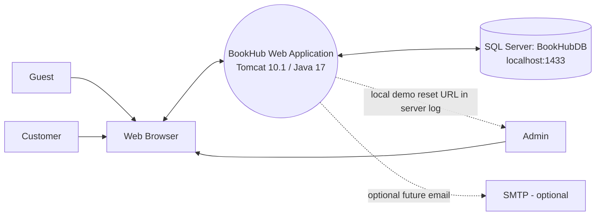
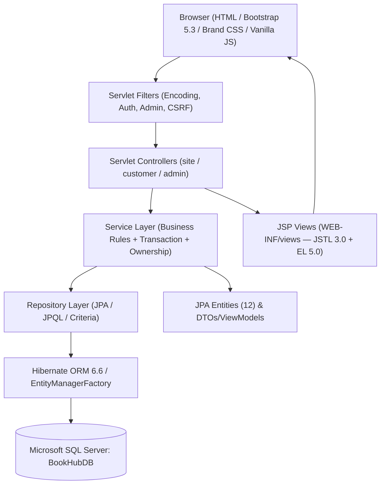
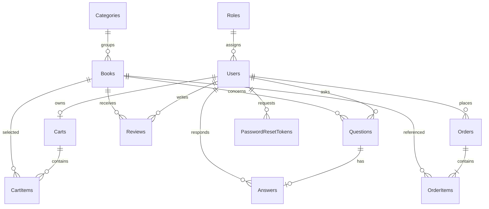
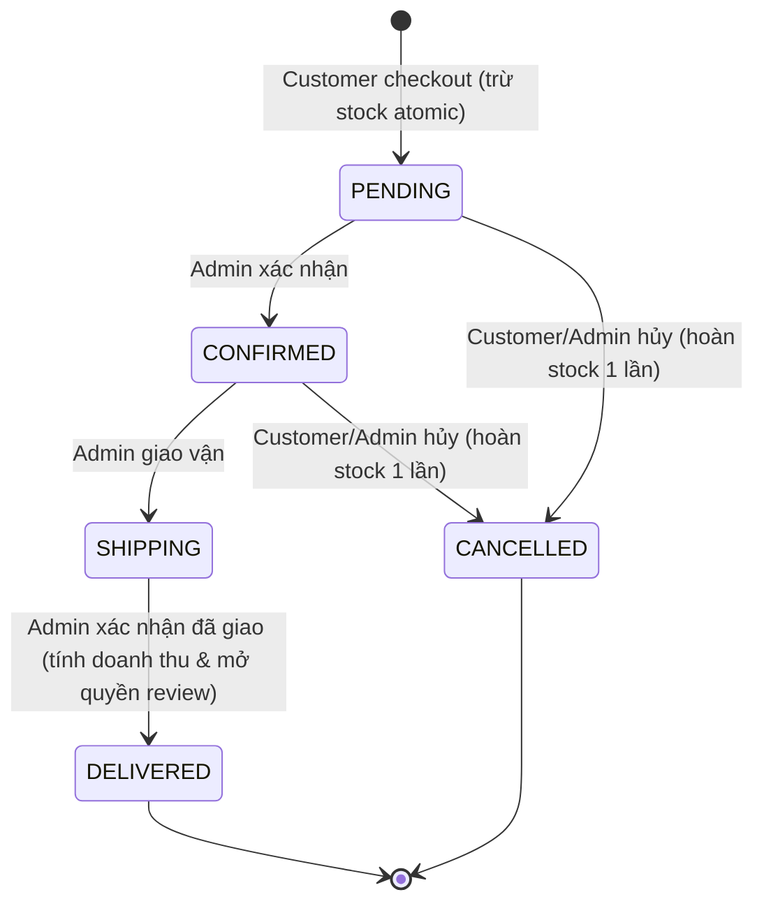

# Kiến trúc hệ thống — BookHub

> Link từ `CLAUDE.md §3`. Nguồn đặc tả đầy đủ: `BookHub_PRJ301_Project_Plan_Requirements.md` (§5, §15–§18). Cập nhật khi thêm module/tầng/bảng mới.

## 1. Bối cảnh hệ thống (System Context)

- **Trong ranh giới hệ thống:** Authentication & RBAC, Public Catalog, Cart, Checkout COD, Order Management, Review Moderation, Q&A, Admin CRUD & Reporting, JPA/Hibernate Persistence.
- **Ngoài ranh giới hệ thống (Out of Scope MVP):** Payment gateway online, hãng vận chuyển/tracking real-time, ERP/POS, nhiều người bán (marketplace), email marketing.

## 2. Kiến trúc phân tầng (Layered MVC + JPA/Hibernate)

### Trách nhiệm từng tầng
| Tầng | Package / Thư mục | Nhiệm vụ | Cấm |
|---|---|---|---|
| **Filter** | `com.bookhub.filter` | UTF-8 encoding, kiểm tra phiên đăng nhập, kiểm tra role `ADMIN`, xác thực CSRF | Không chứa business transaction |
| **Controller** | `com.bookhub.controller.{site,customer,admin}` | Đọc/parse HTTP params, gọi Service, gắn attribute/DTO, forward JSP hoặc redirect (PRG) | Không viết JPQL/SQL hoặc logic tính tiền/tồn kho |
| **Service** | `com.bookhub.service` | Nghiệp vụ, validate có thẩm quyền, begin/commit/rollback transaction, ownership check, state machine | Không render HTML/JSP |
| **Repository** | `com.bookhub.repository` | CRUD & truy vấn JPA/JPQL/Criteria (parameter binding, DB pagination) | Không tự commit transaction; cấm DAO JDBC thuần |
| **Entity / DTO** | `com.bookhub.entity`, `com.bookhub.dto` | Mapping bảng SQL Server; DTO projection cho View & báo cáo | Không truyền lazy Entity chưa load sang JSP; không lộ `password_hash`/`token_hash` |
| **View (JSP)** | `web/WEB-INF/views/` | Render HTML bằng JSTL 3.0 (`jakarta.tags.*`) + EL `${...}` + `<c:out>` | Cấm scriptlet `<% %>`, cấm `<sql:*>`, cấm truy cập DB |

## 3. Luồng xử lý Request & Quản lý JPA
1. Browser gửi HTTP request → `EncodingFilter` đặt UTF-8.
2. `AuthenticationFilter` / `AdminAuthorizationFilter` / `CsrfFilter` chặn request chưa xác thực, sai role hoặc thiếu CSRF token (POST).
3. Servlet Controller parse dữ liệu, gọi Service.
4. `EntityManagerFactory` khởi tạo **1 lần (singleton)** lúc `ServletContext` startup từ `BookHubPU` + override `bookhub-local.properties`, và đóng lúc shutdown.
5. Mỗi thao tác Service mở/đóng `EntityManager` riêng (không dùng chung giữa thread, không lưu vào `HttpSession`), quản lý transaction tập trung.
6. Service trả DTO/ViewModel; Controller forward tới JSP trong `WEB-INF/views/` hoặc dùng **PRG (Post/Redirect/Get)** sau POST thành công.

## 4. Mô hình dữ liệu (ERD — 12 bảng trong `BookHubDB`)

### Tóm tắt 12 bảng & chiến lược toàn vẹn
| Bảng | Khóa chính | Ràng buộc nổi bật | Chính sách xóa |
|---|---|---|---|
| `Roles` | `INT IDENTITY` | `UQ(role_code)` (`ADMIN`, `CUSTOMER`) | Không xóa khi còn User |
| `Users` | `BIGINT IDENTITY` | `UQ(email)`, `CK(status IN ACTIVE/LOCKED/DISABLED)` | Soft-lock (`LOCKED`/`DISABLED`) |
| `Categories` | `INT IDENTITY` | `UQ(name)`, `UQ(slug)`, `is_active` | Soft-deactivate (`is_active = 0`) |
| `Books` | `BIGINT IDENTITY` | Filtered `UX(isbn)`, `CK(price > 0)`, `CK(stock_qty >= 0)` | Soft-deactivate (`is_active = 0`) |
| `Carts` / `CartItems` | `BIGINT IDENTITY` | `UQ(user_id)`, `UQ(cart_id, book_id)`, `CK(quantity > 0)` | Xóa `CartItems` sau checkout thành công |
| `Orders` | `BIGINT IDENTITY` | `UQ(order_code)`, `CK(total_amount = subtotal + shipping_fee)`, `payment_method = 'COD'` | Không hard-delete |
| `OrderItems` | `BIGINT IDENTITY` | Snapshot `book_title_snapshot`, `unit_price`, `CK(line_total = unit_price * quantity)` | Bất biến (immutable) |
| `Reviews` | `BIGINT IDENTITY` | `UQ(user_id, book_id)`, `CK(rating 1..5)`, `PENDING/APPROVED/HIDDEN` | Ẩn bằng `HIDDEN` |
| `Questions` / `Answers` | `BIGINT IDENTITY` | `OPEN/ANSWERED/HIDDEN`, `UQ(Answers.question_id)` (1 câu trả lời/câu hỏi) | Ẩn bằng `HIDDEN` |
| `PasswordResetTokens` | `BIGINT IDENTITY` | `UQ(token_hash)`, `expires_at` (15 phút), `used_at` | Dọn token hết hạn theo cleanup policy |

## 5. Vòng đời đơn hàng (Order State Machine)

## 6. Quyết định kiến trúc (ADRs)
Xem đầy đủ 9 quyết định đã chốt (`ADR-001`..`ADR-009`) tại `.sdd/rfcs/` và tóm tắt ở `CLAUDE.md §7`.
