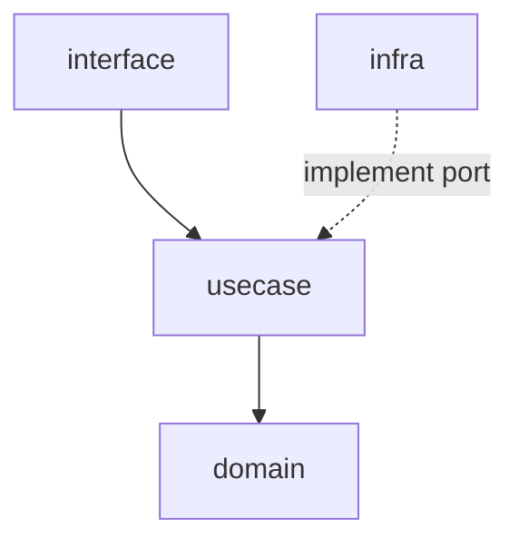

# Kiến trúc hệ thống — {{PROJECT_NAME}}

> Link từ `CLAUDE.md §3`. Cập nhật khi thêm module/tầng/dịch vụ ngoài.

## Bối cảnh hệ thống
```mermaid
flowchart LR
  User[Người dùng] --> App[{{PROJECT_NAME}}]
  App --> DB[({{DB}})]
  App --> Ext[Dịch vụ ngoài]
```

## Phân tầng (khớp constitution A-01)


## Luồng chính
| Luồng | Mô tả | Spec |
|---|---|---|
| {{tên}} | {{...}} | `feat-{{slug}}` |

## Mô hình dữ liệu
{{ERD hoặc link}}
