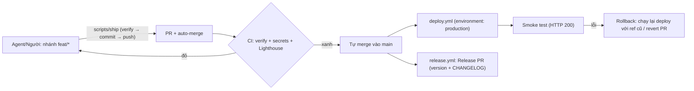

# CI/CD tự động — BookHub

> Mục tiêu: **code vào `main` chỉ qua PR đã xanh CI; Agent không bao giờ push trực tiếp `main` hay deploy tay.**
> *Lưu ý MVP PRJ301:* BookHub deploy local trên Apache Tomcat 10.1.x qua NetBeans 17 / Ant WAR (`docs/runbook.md`); luồng `deploy.yml`/`release.yml` bên dưới áp dụng khi kích hoạt CI/CD mở rộng trên GitHub.

## 1. Luồng

## 2. Ai làm gì
| Việc | Ai | Công cụ |
|---|---|---|
| Push nhánh `feat/*` `fix/*` `chore/*`… | Agent hoặc người | `scripts/ship` (verify đầy đủ trước; **không force**, **không** `--no-verify`) |
| Mở PR + bật auto-merge | `scripts/ship` (cần `gh`) | `gh pr create` / `gh pr merge --auto --squash` |
| Chặn push thẳng `main`, force-push | Máy | `.githooks/pre-push` + branch protection |
| Kiểm tra mỗi PR | CI | `ci.yml`: `verify`, `secrets` (+ Lighthouse nếu `LHCI_ENABLED=true`) |
| Merge vào `main` | GitHub auto-merge | Chỉ khi required checks xanh |
| Deploy production | CI | `deploy.yml` (sau CI xanh; environment `production`) |
| Version, tag, CHANGELOG, Release | CI | `release.yml` (release-please từ Conventional Commits) |
| Cập nhật dependency | Dependabot | `.github/dependabot.yml` |
| **Deploy bằng tay từ máy** | **Cấm với Agent** | `constraints/safety.md` |

## 3. Cài đặt lần đầu (một lần)
1. Tạo repo GitHub, `git remote add origin …`, push `main` lần đầu bằng người: `ALLOW_MAIN_PUSH=1 git push -u origin main`.
2. `./scripts/setup-github.ps1` (xem trước) rồi `-Apply` (hoặc `.sh --apply`): bật auto-merge, squash-only, tự xóa nhánh, **branch protection** (PR bắt buộc, required checks `verify` + `secrets`, cấm force-push, lịch sử tuyến tính), tạo environment `production`.
3. Điền `.sdd/project.conf`: `INSTALL_CMD`, `BUILD_CMD`, `DEPLOY_CMD`, `SITE_URL`, `SEO_BUILD_DIR`.
4. Trong `ci.yml` và `deploy.yml`: bỏ comment bước setup runtime (node/pnpm/uv…).
5. GitHub → Settings → Environments → `production`: thêm **Secrets** (vd `DEPLOY_TOKEN`) và (tuỳ chọn) **Required reviewers** nếu muốn duyệt tay trước khi lên production.
6. (Tuỳ chọn) Repo **Variables**: `LHCI_ENABLED=true` để chấm Lighthouse mỗi PR (sửa `staticDistDir` trong `lighthouserc.json`). Secret `RELEASE_PLEASE_TOKEN` để CI chạy được trên Release PR.
7. Bật Dependabot: bỏ comment ecosystem bạn dùng trong `.github/dependabot.yml`.

## 4. Ví dụ `DEPLOY_CMD` (đặt trong `.sdd/project.conf`; token lấy từ GitHub Secrets)
| Nền tảng | Lệnh gợi ý |
|---|---|
| Cloudflare Pages | `npx wrangler pages deploy dist --project-name=<tên>` |
| Netlify | `npx netlify deploy --prod --dir=dist` |
| Vercel | `npx vercel deploy --prod --prebuilt` |
| GitHub Pages | dùng `actions/deploy-pages` thay cho bước Deploy |
| VPS/Docker | `ssh … docker compose pull && up -d` (khoá SSH trong Secrets) |

## 5. Rollback
- **Nhanh:** Actions → `deploy` → *Run workflow* → nhập `ref` = SHA/tag bản tốt trước đó.
- **Chuẩn:** tạo PR `revert` (bằng `scripts/ship`) → auto-merge → deploy tự chạy lại.
- Migration DB luôn có `down`; thay đổi phá huỷ theo expand → migrate → contract (`safety.md`).

## 6. Quy ước để auto-merge hoạt động
- Tên nhánh `type/slug`; commit theo Conventional Commits (để release-please tính version).
- PR nhỏ, xanh `verify`; không sửa test để qua; bí mật không bao giờ vào repo (`secrets` job + fallback regex).
